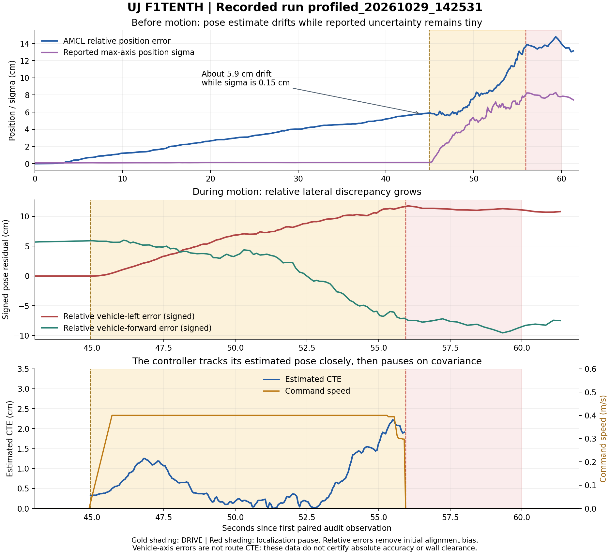

# Recorded localization findings and the next controlled check

Run: `profiled_20261029_142531`. Analysis uses the supplied 255-row passive truth
CSV, 1,191-row controller CSV, AMCL/EKF/controller logs, runtime YAML and scan
seed. Input checksums and exact numeric results are in
[the metrics record](evidence/profiled_20261029_142531_metrics.json).



## What the data establishes

| Measurement | Result | Interpretation |
| --- | --- | --- |
| DRIVE commands before pause | 11.0 s, peak 0.40 m/s | Short moving segment; zero completed laps |
| Accepted moving truth intervals | 91, 10.80 s, 4.142 m | Motion statistics exclude stationary preparation |
| Moving AMCL relative position RMSE / maximum | 0.087 / 0.139 m | Measured relative disagreement, not independently registered absolute error |
| Moving controller estimated CTE maximum | 0.0222 m | The controller tracks estimated state closely while localization discrepancy grows |
| Relative position drift immediately before driving | 0.05866 m | Simulator true position remained stationary before arming |
| Reported max-axis position sigma then | 0.00146 m | Particle dispersion is not evidence of millimeter accuracy |
| Relative position error near first pause | 0.1361 m | Closest audit observation precedes the controller STOP by 44.8 ms |
| Vehicle-left relative error near pause | 0.1162 m | This is a true-vehicle-axis residual, not route CTE |
| EKF relative position error near pause | 0.1140 m | Odometry/model errors also need investigation after startup is repaired |
| Truth pairing lag, rounded CSV maximum | 0.002 s | The 180 ms allowed lag was not realized in these data |

The first STOP reason is `LOCALIZATION PAUSE: AMCL confidence temporarily low`.
After 4.05 s of controller time, it latches because AMCL did not recover within
the configured four-second pause. The observed position sigma did not reach the
0.064 m recovery target. This run did not initially stop because the pose was
stale, an obstacle guard triggered or the controller's estimated CTE exceeded
its limit. The supplied AMCL log contains no reported queue-overflow or TF-drop
warning; that does not prove the entire runtime was fault-free. The EKF log
contains only shutdown information and cannot explain its drift.

All truth errors use one rigid alignment at the first paired observation. This
removes initial registration bias; these values cannot establish absolute map
accuracy, true route CTE, wall clearance, or calibrated uncertainty coverage.
The signed vehicle-frame residual changes direction as the car turns; it is
not identical to a newly accumulated lateral drift from the instant of arming.

## Confirmed initialization-contract defect

The recorded runtime YAML contains `set_initial_pose: true` and an
`initial_pose` containing x/y/yaw only. Our launcher treated a scan-match
hypothesis as effectively certain.

In the inspected [Nav2 Humble source](https://api.nav2.org/nav2-humble/html/amcl__node_8cpp_source.html),
`AmclNode::on_activate()` (source lines 271-281) creates a
`PoseWithCovarianceStamped`, sets pose and header, and passes it to
`initialPoseReceived()` without assigning covariance. `handleInitialPose()`
(source lines 602-611) copies that covariance into the particle initializer.
The message's default covariance is zero. Source blob inspected through GitHub:
`0fa2f94c54a501893eaa862eb956d9fc8d7f4252` on the `humble` branch.

This explains why the old startup method supplies no meaningful uncertainty.
The tiny recorded startup dispersion is consistent with that defect. It is
not proof that this is the sole cause of stationary drift, EKF drift or the
failure to finish a lap. The exact installed Nav2 package version was not
included in the uploaded files.

## The implemented change

`run_profiled_saved_map.py` now disables parameter-only initialization for its
own run and calls `initialize_amcl_pose.py` after AMCL lifecycle activation.
The helper:

1. Uses the existing live scan-match x/y/yaw, without reading simulator truth.
2. Sends one `/initialpose` message with explicit covariance in `slam_map`.
3. Waits for a subscriber before sending and a fresh valid AMCL pose afterward.
4. Aborts initialization on failure; it does not silently fall back to a
   zero-covariance seed or repeatedly reset the particle filter.
5. Saves the supplied prior and acknowledgement timestamps to
   `amcl_initial_pose.json`. A fresh reply acknowledges the startup exchange;
   it does not independently verify pose accuracy.

The initial experimental standard deviations are 0.10 m in x/y and 5 degrees
in yaw, overridable on the launcher CLI. The corresponding covariance diagonal
is:

```text
Pxx = Pyy = 0.10^2 = 0.01 m^2
P_yaw_yaw = (5*pi/180)^2 = 0.00761544 rad^2
```

These are explicit nonzero experimental assumptions, not a calibrated Gaussian
fit from the scan-match score. They may be insufficient for multimodal/global
localization. A larger particle spread may fail the existing driving gate until
the estimate converges; that is not a reason to loosen the gate.

The passive recorder now appends exact paired source timestamps, aligned truth
coordinates, EKF coordinates and the complete x/y/yaw covariance submatrix.
Existing columns retain their order. New covariance data will allow proper
route-frame projection and timing checks in the next analysis.

## Next check: stationary localization, with no controller armed

Do not rerun exploration. Use the already saved map and route. Start the usual
simulator in Terminal 1. In Terminal 2 create a separate worktree so existing
laptop changes and logs remain intact:

```bash
cd ~/f1tenth_sim
git fetch origin engineering/localization-evidence-20261029
git worktree add --detach ~/f1tenth_sim_seed_check \
  origin/engineering/localization-evidence-20261029
cd ~/f1tenth_sim_seed_check
source ~/f1tenth_sim/scripts/sim_env.zsh
cd ~/f1tenth_sim_seed_check
python3 -u tools/mission/run_profiled_saved_map.py \
  --localization-only --observe-seconds 45
```

This still uses the optimized candidate CSV already generated in
`~/f1tenth_sim/results/missions/20261028_112407/new_track_body_optimized.csv`.
The existing preflight rejects an already-running AMCL/SLAM or competing drive
publisher. Stop the previous mission normally before starting another. If the
new worktree path already exists, reuse it only after checking its revision;
do not delete or overwrite it.

The observer prepares localization and records stationary data, without
starting the autonomous controller or sending an arm request. It requests
stationary updates approximately once per second through ROS CLI; this cadence
differs from the old disabled controller, so this is a startup diagnostic, not
a controlled proof that covariance initialization alone removes all drift.
Normal cleanup sends a zero-speed command. A successful observation period
means data were collected, not that localization accuracy passed.

Send the new `localization_truth_audit.csv`, `amcl_initial_pose.json`, `amcl.log`,
`ekf.log` and `recovered_map_amcl.yaml` from the printed run directory. Check
stationary true displacement, estimated drift, full covariance, scan/pose
timing and the actual Nav2 version before deciding on another moving test.

## Validation and limits

The expanded offline suite contains 29 passing tests, including variance units,
invalid/underflowing/overflowing priors, a single publish with fresh
acknowledgement, timeouts, observer routing with no controller/arming, startup
failure abort and backward-compatible recorder columns. The figure was
visually inspected. Existing offline geometry checks are preserved.

No ROS 2 graph or new simulated lap was run in the editing environment. No
threshold, steering law, safety gate, EKF model or hardware configuration was
changed in this step. The next live observation remains necessary.
