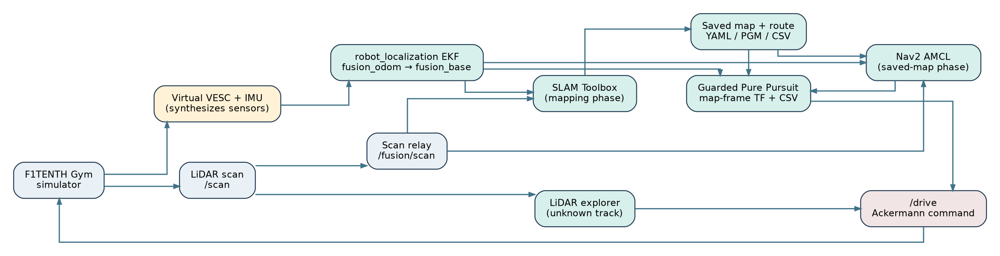
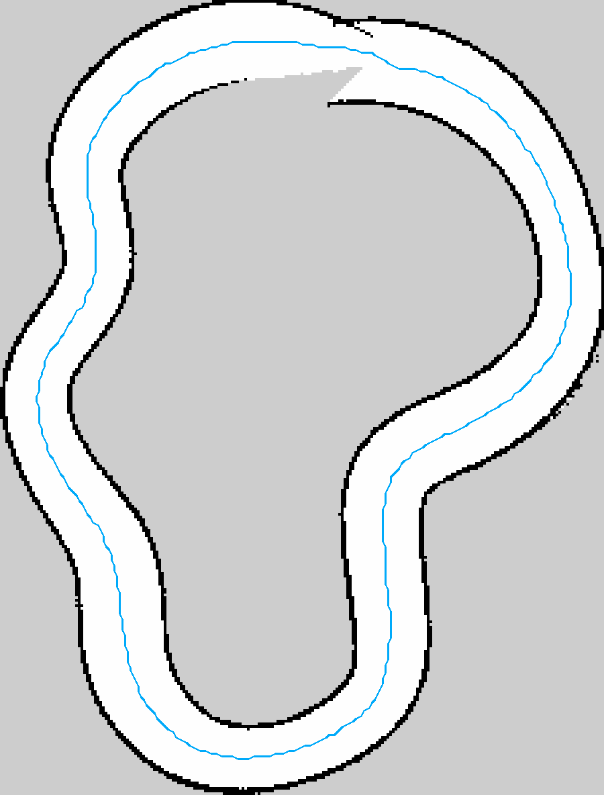
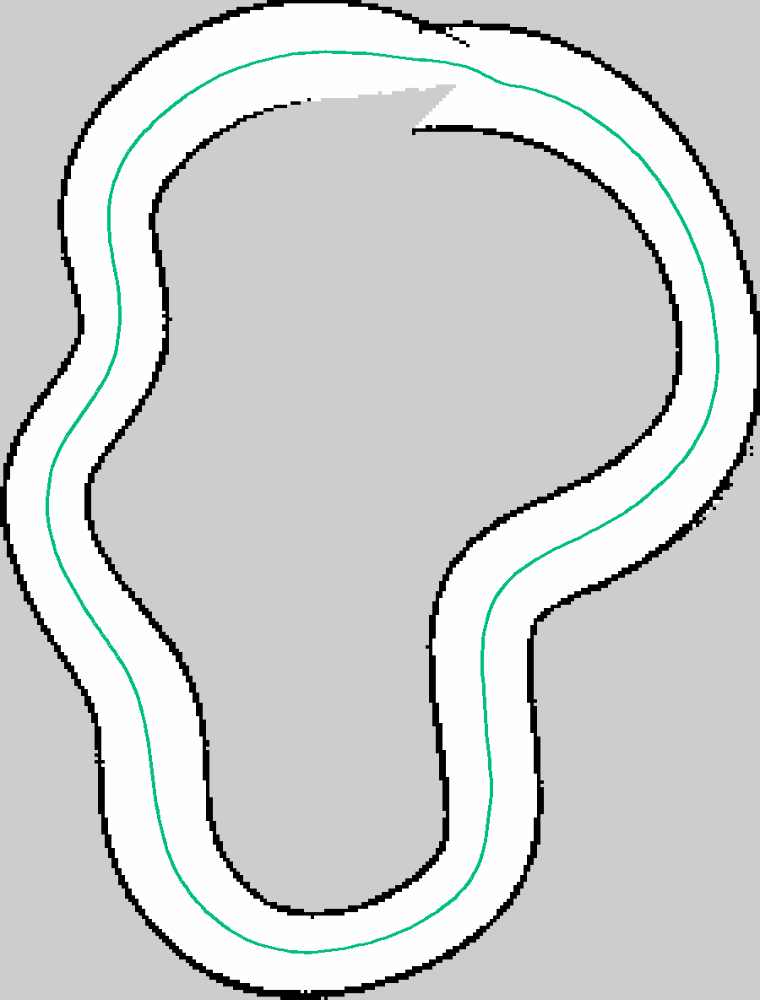
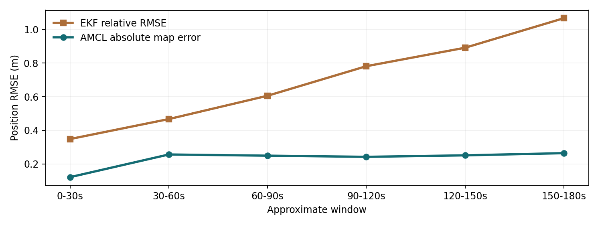
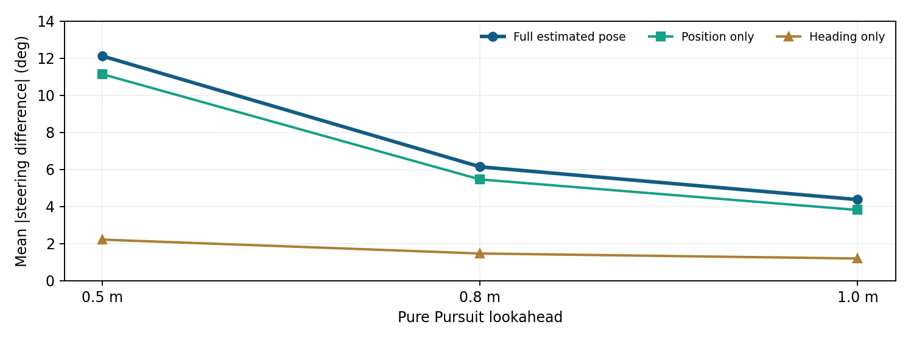
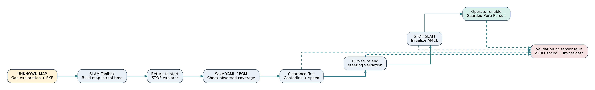

# Executive summary

**Project objective.** Develop a reproducible research and engineering platform for a 1/10-scale Ackermann-steered autonomous vehicle. The complete target mission is: enter an unfamiliar closed circuit; use LiDAR to navigate a first exploratory lap; construct a metric occupancy map with SLAM; detect and validate a loop; extract a drivable closed trajectory and speed profile; use wheel/IMU odometry and LiDAR-based localization on that saved map; and autonomously traverse the circuit. The simulation work is also the commissioning environment for the University of Jordan F1TENTH physical prototype.

**Assessment at the end of 28 October 2026.** The system has demonstrated (1) LiDAR-only local navigation in an initially unmapped simulator circuit, (2) SLAM map saving, (3) a valid clearance-first 377-point, 37.67 m centerline recovered from the first mapping lap, (4) a kinematically feasible 37.58 m variant checked against a 24-degree steering constraint, (5) independent simulated wheel/IMU fusion with an EKF, (6) AMCL map localization, and (7) a complete *separate known-map* estimated-pose autonomous lap at 0.35 m/s. A resumed autonomous attempt **on the newly explored and recovered map** progressed to waypoint **56/377** at 0.15 m/s, then stopped on cross-track error and stale AMCL pose. The combined exploration-to-racing mission has **not** yet completed an end-to-end autonomous lap. No physical car actuation or real-sensor commissioning is claimed.

**Three principal contributions.** First, the team decoupled simulator truth from the navigation estimator: noisy VESC-like velocity and IMU angular-rate measurements are fused by robot_localization, and AMCL corrects the local odometry with a saved LiDAR map. Second, the first-lap mission connects exploration, SLAM, map saving, centerline extraction, map-relative localization and Pure Pursuit into one software workflow with explicit state gates. Third, a failure on a genuine saved SLAM map led to a clearance-first path-extraction method and an independent steering-feasibility correction. The corrected path was evaluated against real occupied/unknown grid cells rather than by artificially clearing unobserved areas.

**Research integrity.** Every reported measurement is labeled by test conditions. Ground-truth odometry is still present in the simulation for an oracle baseline and for the *sensor emulator*, but it is not used as the driving state in the estimated-pose controller. Estimated cross-track error is *not* equivalent to measured simulator-truth tracking error. A grid-based 0.30 m centerline clearance is *not* a guarantee of 0.30 m clearance around the full car body.

## Current acceptance ledger

| Milestone | Status | Evidence / limitation |
|---|---|---|
| Technical simulator and Foxglove | Demonstrated | Gym bridge, map and ROS topics available |
| Known-track Pure Pursuit with oracle state | Demonstrated | 5 consecutive laps, 26.5 s in earlier setup; later ~29.2 s at reduced profile |
| Generated and saved first SLAM track | Demonstrated | `.yaml` + `.pgm`; original serialized graph also saved in earlier workflow |
| Wheel/IMU emulator and EKF | Demonstrated in simulation | Biased/unbiased tests; no physical VESC telemetry yet |
| AMCL map localization | Demonstrated with limitations | Typical 0.21-0.25 m error; occasional severe localization failure |
| Estimated-pose closed-loop known-map lap | Demonstrated | Complete lap, 0.35 m/s, safety-gated, 344-point reference |
| First-lap autonomous unknown-track traversal | Demonstrated once | 34.422 m estimated odometry travel; return within 0.85 m |
| Clearance-first generated map route | Demonstrated offline | 377 points, 37.67 m, 0.30 m sampled grid clearance |
| Feasible steering route | Geometrically validated | 377 points, 37.579 m, <=21.43 deg peak dense-sampled steering |
| New-map resumed autonomous lap | Partial / blocked | Stopped at index 56/377, estimated CTE 0.170 m; AMCL then stale |
| Physical Jetson/LiDAR/VESC/servo integration | Not established here | Bench bring-up, calibration, independent E-stop required |

# 1. Project scope and operating concept

## 1.1 Why the simulator is necessary

The simulator is not merely a visualization: it provides a repeatable test bench for the perception, estimation, planning and control software before hardware risk is introduced. We can vary track width and shape, LiDAR characteristics, steering and speed, odometry noise and bias, map completeness, localization initialization and controller gains. It gives deterministic oracle measurements for *evaluation*, while a separate constrained estimated-state pipeline can be tested independently. The same ROS topic and frame interfaces are intended to transfer to a Jetson.

There are three distinct navigation problems. **Exploration** selects a locally traversable direction when no global map/route is available. **SLAM** estimates a map while resolving pose drift and loop closure. **Localization and racing** use a validated saved map and a path in its coordinate frame to perform controlled laps. Confusing these stages led to previous map-frame errors and unsafe path choices, so the mission runs them in strict phases.

## 1.2 Physical F1TENTH design context

The planned platform is a roughly 1/10-scale Ackermann car with approximately 0.3302 m wheelbase. Planned hardware includes Jetson Orin Nano 8 GB (Ubuntu 22.04 and ROS 2 Humble), LakiBeam L1 LiDAR, a VESC-compatible brushless motor controller (Makerbase VESC MINI 6.7 Pro candidate), a brushless propulsion motor (DYS D3542 1450 KV candidate), a high-torque FT5330M steering servo, and an IMU whose final model and calibration remain to be fixed. These are the intended integration targets, not proof of installed or tested electrical interfaces. The steering servo needs an independent appropriately rated supply and a validated PWM signal path; Jetson GPIO is not a drop-in servo-power supply.

The development stack currently uses a simulator sensor emulator rather than the actual VESC, IMU or LakiBeam. The motor gear ratio, wheel diameter, pole pairs, encoder count and servo endpoints must be measured or validated on the real chassis rather than copied blindly from simulation constants.

# 2. Software, computer setup and repository

## 2.1 Development environment

| Component | Current setup / role |
|---|---|
| OS | Ubuntu Linux development laptop; ROS 2 Humble |
| ROS workspace | `~/f1tenth_sim` |
| Shell | zsh; `source scripts/sim_env.zsh` |
| ROS domain | `ROS_DOMAIN_ID=42` |
| RMW | `rmw_cyclonedds_cpp` |
| Python | Workspace `.venv`, ROS 2 Python libraries and scientific stack |
| Simulator | `f1tenth_gym` through ROS bridge (`f1tenth_gym_ros`) |
| Visualization | Foxglove via ROS Foxglove bridge on WebSocket 8765 |
| Estimation | `robot_localization` EKF, Nav2 AMCL, `slam_toolbox` |
| Mapping | Occupancy-grid `.yaml` and `.pgm`, optional serialized SLAM graph |
| Planning | NumPy, SciPy, scikit-image, Pillow and PyYAML |
| Repository | `https://github.com/EngZaq/f1tenth_uj_sim` |

As checked on 28 October, the public `main` branch pointed to commit `68ec82891f593d87b9626352cc21576b7270200a` from 27 October. Its README still describes an earlier phase. The newer mission, EKF, AMCL and route artifacts exist in the local workspace/packages and must be committed from the laptop before the remote can be described as up to date. The physical-car codebase is a separate repository, `EngZaq/f1tenth_uj`, and should not be confused with this simulator workspace.

## 2.2 Workspace conventions

```text
~/f1tenth_sim/
  scripts/                       Environment, simulator, combined launchers
    sim_env.zsh                 Source ROS + venv + DDS settings
    run_sim.zsh                 Gym + bridge + Foxglove
    run_autonomous_amcl_sim.zsh Known-map estimated-pose controller launcher
    run_unknown_track_mission.zsh  Exploration -> mapping -> handoff
    run_resume_saved_track.zsh  Resume the generated map after simulator restart
  src/f1tenth_control/          Original racing Pure Pursuit ROS package
  tools/
    exploration/               Gap-following and experimental arc planners
    fusion/                    VESC/IMU sensor emulator, evaluation
    localization/              Scan relay, AMCL experiments, shadow comparison
    planning/                  Centerline, registration, speed-profile tools
    mission/                   First-lap watcher, mission runner, saved-map resume
  config/                       EKF, simulated sensor, AMCL, SLAM settings
  maps/                         Simulator track fixtures
  reference/generated/          Known-map path and speed profile
  results/mapping/              Generated historic SLAM map / graph
  results/localization/         EKF/AMCL, shadow and controller CSV results
  results/missions/20261028_112407/
    new_track.yaml              First-lap SLAM metadata
    new_track.pgm               First-lap occupancy raster
    lap_pose.json               Loop detection and SLAM-frame finish pose
    new_track_centerline.csv    Clearance-first path, original orientation
    new_track_mission_forward.csv  Explorer travel direction
    new_track_speed_profile.csv Planned conservative velocities
    new_track_mission_forward_feasible.csv  Corrected route
    new_track_preview.png       Map/path visual evidence
    new_track_diagnostic.png    Earlier failed extraction diagnosis
    resume_*/                   Saved-map driving attempt logs
```

ROS `build/`, `install/`, `log/`, `.venv/` and Python caches are generated, and should not be committed. `src/f1tenth_gym_ros/` is ignored as a separately managed simulation dependency in the current repository; clean clone reproducibility requires documenting how that dependency is obtained and built.

# 3. End-to-end autonomy architecture



## 3.1 Data flow and frame ownership

**First lap, unknown map.** The local explorer reads `/scan` directly and chooses a collision-averse direction, publishing `/drive` *only in the simulator*. The virtual VESC/IMU producer converts simulation state into noisy wheel-speed and yaw-rate sensor messages. The EKF estimates `fusion_odom -> fusion_base`. The independent scan relay gives `/fusion/scan` the `fusion_laser` frame. SLAM Toolbox consumes fused local odometry and LiDAR and owns `slam_map -> fusion_odom`; it publishes the mapping occupancy grid on `/mission/slam_map`. A first-lap watcher measures loop-return conditions from EKF/SLAM, not from oracle odometry.

**Saved-map lap.** Stop SLAM Toolbox before starting AMCL; otherwise the same `slam_map -> fusion_odom` TF edge may have competing publishers. AMCL and the map server load the saved `new_track.yaml`, consume `/fusion/scan` and fused odometry, and own the global map correction. The driving controller asks TF for `slam_map -> fusion_base`, computes Pure Pursuit in the identical map frame as the generated route, and publishes `/drive` with a watchdog and explicit operator enable.

**Oracle branch.** `/ego_racecar/odom` is simulator ground truth. It is allowed into the sensor emulator to synthesize readings and into evaluation tools to calculate errors. It is not allowed directly into the estimated-pose steering or first-lap path planner. The old oracle controller intentionally uses it as a baseline and must never run concurrently with the estimated-pose controller.

## 3.2 Important topics, messages and transforms

| Name | Message / transform | Purpose |
|---|---|---|
| `/scan` | `sensor_msgs/msg/LaserScan` | Simulator laser; `ego_racecar/laser` frame |
| `/fusion/scan` | `sensor_msgs/msg/LaserScan` | Rate-controlled scan in `fusion_laser` frame |
| `/ego_racecar/odom` | `nav_msgs/msg/Odometry` | Privileged simulator reference/evaluation |
| `/odometry/filtered` | `nav_msgs/msg/Odometry` | EKF fused local odometry |
| `fusion_odom -> fusion_base` | TF | Local odometry transform; EKF owner |
| `fusion_base -> fusion_laser` | Static TF | Relay laser extrinsic, currently +0.275 m x |
| `/mission/slam_map` | `nav_msgs/msg/OccupancyGrid` | Current first-lap SLAM map |
| `/fusion/localization_map` | `nav_msgs/msg/OccupancyGrid` | Saved occupancy map for AMCL |
| `/amcl_pose` | `geometry_msgs/msg/PoseWithCovarianceStamped` | Global map-relative pose + covariance |
| `slam_map -> fusion_odom` | TF | SLAM during mapping OR AMCL afterward |
| `/drive` | `ackermann_msgs/msg/AckermannDriveStamped` | Simulator actuation; exactly one active publisher |
| `/amcl_drive/enable` | `std_msgs/msg/Bool` | Operator enable/disable gate |
| `/ego_racecar/collision` | `std_msgs/msg/Bool` | Simulator collision event / stop latch |
| `/initialpose` | `geometry_msgs/msg/PoseWithCovarianceStamped` | Optional pose reset; Foxglove can publish |

**Laser-frame caveat.** The observed `ego_racecar/base_link -> ego_racecar/laser_model` URDF visual transform was `[+0.096,0,+0.122]` m, whereas `fusion_base -> fusion_laser` currently uses `[+0.275,0,0]` m. However `/scan` was actually stamped `ego_racecar/laser`, *not* `laser_model`. Therefore these two measurements alone do not establish that the LiDAR relay is wrong; the actual laser ray origin and physical mount still require verification. Mapping and scan-based startup currently depend on a consistent +0.275 m assumption, so do not change only one component.

## 3.3 Engineering mathematics

Bicycle kinematics (planar approximation):

`x_dot = v cos(psi)`, `y_dot = v sin(psi)`, `psi_dot = v tan(delta)/L`.

Pure Pursuit chooses a target point at arc-length lookahead along the path. In vehicle coordinates, let its lateral offset be `y_L` and Euclidean distance `d_L`; commanded steering is `delta = atan(2 L y_L / d_L^2)`, saturated to the steering limit. The value **L** here denotes wheelbase; lookahead distance is a different parameter. At shorter lookahead the same 0.1-0.2 m position error can create much larger steering differences.

Geometric path feasibility uses `delta_required = atan(L * kappa)` where `kappa` is path curvature. A smooth path can be free of obstacles yet demand more curvature than the car can steer. The path planner therefore checks **both** known-free-space clearance and curvature/steering feasibility.

For planning speed, a curvature-limited candidate is `v <= sqrt(a_y_max/|kappa|)` and is further constrained by forward-acceleration and reverse-braking passes. The generated profile is a *planning artifact*; early estimated-pose tests deliberately use a lower **constant speed cap**, not this optimized profile.

# 4. Maps, datasets and track families

## 4.1 Simulator maps and known-track data

The repository and development archives contain an oval-debug fixture, a technical-loop track (`uj_technical_loop_v1`), and generated centerlines. The technical simulator loads `maps/uj_technical_loop_v1.yaml`; its bridge begins near `(-5.80,-2.10,2.17 rad)`. A scaled simulator map for visualization was observed at **720 x 480 cells** with **0.025 m** resolution. This is *not* the SLAM occupancy grid.

The earlier known-track SLAM result lives under `results/mapping/uj_technical_slam_01.yaml` and `.pgm`: **287 x 183 cells**, resolution **0.05 m**, origin `[-7.17,-4.44]`. Historical saved SLAM artifacts included `.posegraph` (~30 MB) and `.data` (~8.4 MB). The known-track centerline has **344** waypoints and an accompanying speed profile. For oracle racing only, a registered simulator-frame path was generated; the approximate SLAM-to-simulator rigid rotation is **-2.2434 degrees** and translation `[+0.1397,-0.1590]` m. This registration is not used to localize the physical car.

## 4.2 Newly explored map and recovered route

During the first fully integrated unknown-track attempt, the system saved the map at `results/missions/20261028_112407/new_track.yaml` and `new_track.pgm`: **225 x 296 cells**, **0.05 m** resolution, and origin `[-6.61,-13.6,0]`. These are real output artifacts from the integrated mapping run, not an imported pre-existing track path.



A standalone first-lap detector recorded **34.422 m** EKF-estimated travel, **229.2 s** elapsed, **0.85 m** odometric distance to the departure location and **14.0 degrees** return heading discrepancy. It saved a final pose approximately `(-4.299,-0.636,0.776 rad)` in the `slam_map` frame, after mapping settled. The return-to-start condition does not itself prove that the optimizer detected a globally consistent loop closure; map closure and path validation are separate acceptance tests.

The V3 clearance-first extractor recovered a **37.67 m**, **377-point** centerline with a minimum **0.30 m grid-sampled distance** from unknown/occupied cells and zero sampled crossings. It oriented the path to the explorer's actual travel direction, with **0.3-degree** starting-heading mismatch. The length discrepancy against 34.422 m odometric travel reflects that the numbers describe *different geometries/estimators*, and is not by itself a failure.

The generated path initially exceeded the car's steering limit at four waypoints; dense sampling showed an equivalent peak command above 40 degrees in the raw path. The steering-feasible correction created a **37.579 m** route, still **377 waypoints**, changing points by at most **0.041 m**. Its independent verification output reported **21.43 degrees peak required steering at 5 mm sampling**, **0.300 m minimum sampled grid clearance**, and **zero occupied/unknown intersections**. This is a geometrically feasible **simulation route**, not a guarantee of safe real-world clearance under localization error.



## 4.3 Map and path file formats

A ROS occupancy map is a paired YAML and raster: YAML gives image filename, meters/cell, origin and occupancy thresholds; the PGM encodes white known-free, black occupied and gray unknown cells. The saved YAML must resolve the saved raster path. A centerline CSV is seven **semicolon-separated** values per waypoint: `s_m;x_m;y_m;psi_rad;kappa_1pm;vx_mps;ax_mps2`; comment lines begin `#`. The separate speed-profile CSV records index, distance, XY, curvature, raw and planned speed. A lane centerline exists in `slam_map` coordinates, so every estimated-pose controller must use the map-frame variant, never simulator-frame registered waypoints.

# 5. Chronological engineering development

## Day 1: 26 October - baseline setup, maps and localization alternatives

The baseline environment, compatible technical/oval map packages, exploration proof of concept and SLAM mapping were assembled. Initial map-derived centerline and speed profile were built, and a frame mismatch was discovered when a SLAM-frame path was treated as simulator-frame coordinates. A simulator-assisted registration resolved the oracle-reference collision, but was recognized as a simulation-only development aid. The initial Pure Pursuit algorithm provided repeated low-error laps under privileged oracle pose. RF2O laser odometry, command-bicycle odometry and SLAM localization were investigated as independent pose candidates.

## Day 2: 27 October - controlled estimation experiments

The 27 October engineering log documents five oracle racing laps at ~26.5 s with ~0.026 m mean CTE under one speed setting; a later lower-speed baseline measured ~29.2 s with ~0.027-0.028 m CTE. Earlier synchronized RF2O estimates were smooth but drifted, while direct SLAM localization produced occasional large pose jumps; simply increasing scan rates or replacing odometry with integrated commands did not solve this. This motivated the VESC-like wheel-speed and IMU emulator, EKF, map-relative AMCL particle filter, and paired logging strategy. A correct known-map frame alignment was established instead of accepting offline truth-based fixes in the production localization chain.

## Day 3: 28 October - fused navigation, complete estimated lap and integrated mission

The EKF and AMCL were tested under both unbiased and deliberately biased simulated sensors. The shadow controller compared AMCL steering to oracle steering without acting on the simulator. A TF comparison showed that fresh combined TF barely improved mean disagreement, disproving a simplistic “use the latest transform” fix. Decomposed, timestamp-matched tests isolated position error as the main cause of steering sensitivity. Nevertheless, the guarded AMCL-controlled known-map driver **completed an estimated lap at 0.35 m/s**: its log reached waypoint 341/344 and recorded `ESTIMATED LAP 1 COMPLETE`.

The system then attempted an actual first-lap mission: LiDAR explorer + EKF + SLAM Toolbox built a new map; the loop detector stopped the explorer; the map server saved occupancy artifacts. The **original** skeleton extractor failed on branches. A spur-pruned V2 still failed a valid-clearance check, showing one candidate with 0.05 m clearance. Inspection of the actual saved grid led to the V3 clearance-first extractor, which produced the safe-zone centerline. A further curvature correction made the route kinematically feasible. A restart-aware map-scan matching initializer replaced blind reuse of the historical lap-finish pose. In the subsequent resumed drive at 0.15 m/s, the car reached waypoint **56/377** and stopped because estimated CTE reached **0.170 m**, exceeding the configured threshold (0.12 m), followed by AMCL pose staleness. The stopped vehicle did not resume. Thus the integrated path is available but the *new-map autonomous lap remains pending*.

# 6. Test methodology and quantitative results

## 6.1 Experiment boundaries

A result is meaningful only with its input state source, map/frame, profile, speed cap, lookahead, run duration and whether the CTE is computed using oracle or estimated pose. We report localization **absolute map-registered** error separately from relative first-pose-aligned error, and do not substitute relative error for global correctness. Evaluators may read simulator truth offline; the production controller should not.

## 6.2 Earlier mapping/racing baseline

| Experiment | Key outcome | Qualification |
|---|---|---|
| Early oracle lap sequence | 26.584, 26.537, 26.551, 26.540, 26.528 s | Five consecutive lower-CTE laps; ~1.29 m/s mean commanded speed |
| Oracle lower-speed baseline | ~29.17-29.20 s/lap, mean CTE 0.027-0.028 m | 344-point registered path, ~1.18 m/s mean command |
| Oracle lookahead 0.8 m | 29.018 s; mean CTE 0.044 m; max CTE 0.096 m | Faster in that run but larger mean CTE than 0.5 m |
| Earlier RF2O synced | 1,549 samples; mean relative position error 0.285 m | Smooth estimated motion; not robust global map localization |
| Earlier SLAM synced | 554 samples; mean position error 0.649 m, max 1.806 m | 3 apparent >3 m/s pose jumps, peak 17.33 m/s from corrections |

These were not matched controlled trials; speed setting, time and estimator configuration differed. They are development evidence, not statistical superiority claims.

## 6.3 EKF plus AMCL under sensor bias




In a roughly 176.2-second, 1,304-sample biased-sensor stress run, EKF relative position RMSE was **0.764 m**, while AMCL absolute map-registered RMSE was **0.246 m** (maximum **0.432 m**, 95th percentile **0.390 m**). The paired AMCL *relative* RMSE was **0.442 m**, a distinct first-common-pose-aligned metric; do not compare that directly to absolute EKF values. Successive 30-second windows showed EKF relative RMSE increasing approximately `[0.348,0.467,0.606,0.782,0.892,1.068]` m, whereas AMCL absolute error stayed approximately `[0.121,0.256,0.249,0.242,0.251,0.264]` m. This supports the intended complementary roles of local odometry and global map corrections on the known technical loop. It does not demonstrate immunity from incorrect map hypotheses.

A separate ~31.8-second unbiased run had AMCL absolute map-registered RMSE about **0.236 m**. Mean map path cross-track deviation of AMCL estimates was ~0.114 m, with a substantial along-track offset component. Offline lag analysis suggested about -0.10 s shift improved retrospective RMSE (0.236 to 0.205 m), but no oracle-based correction was introduced into online navigation.

## 6.4 Shadow steering and error decomposition




| Test | Mean absolute disagreement | 95th percentile | Interpretation |
|---|---:|---:|---|
| Raw AMCL vs oracle, 0.5 m lookahead | 11.96 deg | 22.76 deg | Position sensitivity significant |
| TF-fused vs oracle, 0.5 m lookahead | 11.84 deg | 22.21 deg | Only ~0.13 deg improvement; TF age not root cause |
| Decomposition, 0.5 m lookahead | 12.12 deg | 22.22 deg | 534 synchronized moving samples |
| Decomposition, 0.8 m lookahead | 6.14 deg | 11.15 deg | Less sensitive; may cut more corners |
| Decomposition, 1.0 m lookahead | 4.37 deg | 7.78 deg | Lowest steering disagreement, not necessarily best CTE |

In the 534-sample decomposition run, average AMCL position error was **0.223 m**, heading error **2.03 deg**, and mean timestamp match error **1.4 ms**. With 0.5 m lookahead, position-only steering error averaged **11.14 deg** and heading-only averaged **2.21 deg**. These error effects are not additive because Pure Pursuit is nonlinear. A separate failure run briefly produced **8.771 m** mean position error and **136.22 deg** heading error; repeated clean initialization returned to ~0.22 m. The cause of that transient gross mislocalization remains unresolved.

## 6.5 First-lap mission, recovery and latest stopped test

| Milestone / metric | Recorded result |
|---|---|
| First-lap explorer enabled speed | Typically 0.11-0.18 m/s |
| Estimated first-lap distance | 34.422 m |
| First-lap duration | 229.2 s |
| Return positional difference | 0.85 m in local odometry |
| Return heading mismatch | 14.0 deg |
| Saved occupancy grid | 225 x 296 at 0.05 m/cell |
| V1 extractor | Failed: skeleton not a simple loop |
| V2 extractor | Failed: min grid clearance 0.05 m on one collision-free sample path |
| V3 clearance-first output | 377 points, 37.67 m, 0.30 m sampled clearance |
| Steering-feasible variant | 377 points, 37.579 m; 21.43 deg max dense-sampled steering |
| New-map estimated drive | 0.15 m/s; waypoint 56/377 before stop |
| Primary stop reason | Estimated CTE 0.170 m, exceeding 0.12 m configuration |
| Subsequent stop reason | AMCL pose stale (over 13 s in supplied log) |
| Concurrent frontal scan range at stop | ~0.55-0.57 m; not the trigger for the logged CTE stop |

**Interpretation of latest stop.** The controller's safety gate correctly commanded 0 speed rather than driving through an uncertain position. After it stopped, pose freshness failed; this may be related to the AMCL update policy for a stationary robot, but the supplied log does not prove why updates ceased. The CTE spike can reflect path tracking, localization correction, narrow geometry, wrong seed or a mixture. The log does not demonstrate collision, nor does it prove the map is universally raceable. Do not increase the CTE threshold or suppress stale-pose checks just to complete a lap.

# 7. The unknown-track mission: exact state sequence



**Phase A - enter exploration.** Assert `/drive` has no other publisher, all relevant nodes start cleanly and simulator track exists. Start simulated VESC/IMU, EKF, relay and SLAM Toolbox. Enable existing LiDAR gap-following explorer. No map is required as a path-planning input. The vehicle observes forward laser geometry and chooses a conservatively inflated feasible gap. The first-lap watcher records distance from an EKF origin, time since start, proximity to start and heading convergence. This is a track-loop heuristic, not generic map exploration.

**Phase B - stop and commit map.** When first-lap criteria are satisfied, explorer enters a persistent 20 Hz zero-velocity command state. Let SLAM settle, capture current global pose, call Nav2 map saver on `/mission/slam_map`, and verify paired `.yaml`/`.pgm` files exist. Reaching the start does not automatically mean all unknown cells are observed.

**Phase C - compute track route.** Perform occupancy classification. Compute a distance-to-occupied-or-unknown grid. Erode to a known-free planning region with nominal 0.30 m clearance. Skeletonize *that safe region*, remove short dead-end spurs, search for closed-cycle candidates, choose an appropriate track-scale loop, smooth and resample, and validate dense path samples against occupied/unknown space. Orient the path according to the explorer travel tangent and generate curvature and speed profile. Verify steering demand with the car's wheelbase and max steer, correcting infeasible tight segments only inside validated free space.

**Phase D - hand off localization.** Stop SLAM Toolbox so it relinquishes `slam_map -> fusion_odom`. Start Nav2 map server and AMCL against the just-saved occupancy grid. When continuing *without resetting* the simulator, capture a recent map-frame finish pose; when the simulator has restarted, do not reuse it as the current pose. Instead use the current `/fusion/scan` to match against the recovered map, bounded by a plausible initial region, and confirm AMCL agrees with the seed before arming.

**Phase E - guarded autonomous lap.** Start the controller disabled, check pose/scans/odometry freshness, covariance, map-relative CTE, forward clearance, collision flag, pose jumps and duplicate `/drive` publishers. After an explicit user enable, publish low-speed Pure Pursuit commands and track estimated waypoint progress. Stop on an estimated complete lap or any fault. The controller is currently simulation-only.

# 8. Operational runbook - exact commands

## 8.1 Starting any normal simulator session

```bash
cd ~/f1tenth_sim
zsh scripts/run_sim.zsh
```

In a separate **zsh** terminal:

```bash
cd ~/f1tenth_sim
source scripts/sim_env.zsh
ros2 topic info /drive
ros2 topic echo --once /ego_racecar/odom --field pose.pose
```

Before enabling a controller, verify that `/drive` has zero competing publishers. Do not combine a legacy oracle controller, explorer and AMCL driver. Foxglove is available through the simulator bridge; the browser visualization map and the SLAM map may be in different TF frames.

## 8.2 Oracle-Pure-Pursuit baseline (evaluation, not autonomous localization)

```bash
cd ~/f1tenth_sim
source scripts/sim_env.zsh
python3 src/f1tenth_control/f1tenth_control/racing_pure_pursuit.py \
  --ros-args \
  -p waypoints_file:="$HOME/f1tenth_sim/reference/generated/uj_technical_slam_01_registered.csv" \
  -p speed_profile_file:="$HOME/f1tenth_sim/reference/generated/uj_technical_slam_01_speed_profile.csv" \
  -p results_file:="$HOME/f1tenth_sim/results/localization/oracle_baseline.csv" \
  -p use_speed_profile:=true \
  -p speed_scale:=1.0 \
  -p lookahead_distance:=0.5
```

The controller uses `/ego_racecar/odom` and the **registered simulator-frame** path. Use this to benchmark controller quality and to compare later estimated-state methods, not as proof of perception autonomy.

## 8.3 Fusion and AMCL testing as individual nodes

Run each command in a **separate sourced terminal** following the simulator:

```bash
python3 tools/fusion/sim_vesc_imu.py --ros-args \
  --params-file config/fusion_sim_sensors_unbiased.yaml
ros2 run robot_localization ekf_node --ros-args \
  --params-file config/fusion_ekf.yaml
python3 tools/localization/fusion_scan_relay.py
ros2 launch tools/localization/fusion_amcl.launch.py
```

These are four independent long-running processes; do not paste all sequentially into one terminal and expect the later commands to start. Verify:

```bash
ros2 lifecycle get /fusion_map_server
ros2 lifecycle get /amcl
ros2 topic hz /fusion/scan
ros2 service list -t | grep nomotion
ros2 topic echo --once /amcl_pose --field pose.pose
```

Both lifecycle nodes should show `active [3]`; `/fusion/scan` was typically ~8.1-8.4 Hz. With AMCL active, a stationary update can be requested via `ros2 service call /request_nomotion_update std_srvs/srv/Empty '{}'`. If no AMCL node exists, that service will not exist: the simulator's own map server is not AMCL.

## 8.4 Known-map closed-loop estimated-pose lap (demonstrated)

With old nodes stopped, use two terminals:

```bash
# Terminal A
cd ~/f1tenth_sim
zsh scripts/run_sim.zsh

# Terminal B
cd ~/f1tenth_sim
zsh scripts/run_autonomous_amcl_sim.zsh
```

After the launcher verifies the stack and prints its stopped/disabled prompt, use **Enter** to enable simulation-only control. It uses `slam_map` path, AMCL+EKF TF and a conservative 0.35 m/s cap. A lap was observed as `ESTIMATED LAP 1 COMPLETE`. Always run the launcher only with the known-map configuration; it must not be used with a different path without confirming matching map and initial pose.

## 8.5 First-lap unknown-track exploration and mapping (demonstrated through saving)

After stopping every prior stack:

```bash
# Terminal A
cd ~/f1tenth_sim
zsh scripts/run_sim.zsh

# Terminal B
cd ~/f1tenth_sim
zsh scripts/run_unknown_track_mission.zsh
```

The mission asks for Enter to start exploration. It then stops the explorer after its first-lap condition, saves a map and tries to generate a path. If path extraction fails, **do not bypass clearance or allow racing**. The first run saved `results/missions/20261028_112407/new_track.*` but did not automatically complete a second AMCL lap; that stage was repaired separately.

## 8.6 Offline recovery - no simulator and no driving required

```bash
cd ~/f1tenth_sim
source scripts/sim_env.zsh
python3 tools/mission/recover_saved_map.py \
  results/missions/20261028_112407
```

After installation of the V3 clearance-first extractor, this produced 377 map-frame waypoints. The feasible-route package adds `new_track_mission_forward_feasible.csv` alongside, without replacing the original path. The verifier for the feasible route checks saved-map hashes and dense clearance/curvature. It does **not** validate AMCL initialization or real-life collision clearance.

## 8.7 Resuming the recovered map after a restart (partial success)

```bash
# Terminal A
cd ~/f1tenth_sim
zsh scripts/run_sim.zsh

# Terminal B
cd ~/f1tenth_sim
zsh scripts/run_resume_saved_track.zsh
```

The runner starts emulator + EKF + scan relay, scans the *live* environment to seed localization near the saved map, launches AMCL against `new_track.yaml`, and loads `new_track_mission_forward_feasible.csv`. The operator must enable driving. Current conservative settings are **0.15 m/s**, max estimated path error **0.12 m**, and front stop distance **0.5 m**. The last recorded run **stopped at 56/377** because estimated CTE reached 0.170 m, followed by stale AMCL pose. Treat this as the reproducible starting point for the next development session, not a completed lap.

## 8.8 Safely stopping the workspace

Use `Ctrl+C` in the active mission/controller terminal, then stop its simulator terminal. Confirm that the `/drive` topic no longer has an active nonzero-command publisher and that the relevant AMCL/SLAM nodes exited. Publishing a single zero message is useful but **not a fail-safe physical emergency stop**. Do not enable the physical motor controller until the hardware safety chain is separately commissioned.

# 9. The generated packages and their roles

| Package or tool | Purpose | Present maturity |
|---|---|---|
| `UJ_F1TENTH_Ready_Maps.zip` / compatible maps | Technical and debug oval simulator tracks and map metadata | Map fixtures |
| `f1tenth_sim_runbook.zip` | Environment sourcing, simulator launch and checks | Baseline developer tooling |
| `F1TENTH_VESC_IMU_EKF_Simulation.zip` | Simulated VESC/gyro messages, EKF params, metrics evaluation | Simulated sensors only |
| `amcl_shadow_pure_pursuit.py` | Compute shadow control from AMCL; never publish `/drive` | Diagnostic |
| `amcl_tf_shadow_compare.py` | Raw AMCL pose vs latest TF lookahead steering A/B | Diagnostic |
| `steering_error_decomposition.py` | Isolate position-only and yaw-only steering errors | Diagnostic |
| `amcl_autonomous_sim_package.zip` | Actual low-speed, guarded AMCL/EKF simulator `/drive` controller | Demonstrated known-map lap |
| `unknown_track_to_amcl_mission.zip` | Orchestrated explore/map/plan/localize/drive sequence | Mapping phase demonstrated; full second lap pending |
| `unknown_track_map_fix.zip` | Spur pruning; saved-map offline recovery | Superseded V1 |
| `unknown_track_map_fix_v2.zip` | Progressive spline/linear smoothing with clearance diagnosis | Failed safely on first actual saved map |
| `uj_track_recovered_v3.zip` | Clearance-first erosion, skeleton, cycle extraction | Demonstrated on actual map |
| `uj_feasible_route_fix.zip` | Kinematic curvature correction and 5-mm verification | Geometric validation demonstrated |
| `uj_saved_map_resume.zip` | Restart-aware scan-to-map initialization and AMCL driving | Partial recovered-map driving to waypoint 56 |

Package ZIPs are development-delivery artifacts, not a substitute for a clean source repository. The GitHub repository should contain the **installed source files, configurations and curated reference outputs**, while older incremental ZIPs and failed prototypes can live under an archival release or dated development documentation.

# 10. Failure analysis and safeguards

**Frame mismatch and oracle registration.** A SLAM-frame centerline is geometrically displaced from the simulator frame; feeding the wrong file to the wrong controller caused collision. **Correction:** keep explicit map-frame paths for AMCL and simulator-frame paths only for the oracle baseline, with registration recorded but not used as a localization substitute.

**RF2O vs SLAM pose instability.** Smooth local odometry can drift without a global correction; map localization can produce implausible position discontinuities. **Correction:** combine physically inspired wheel/IMU EKF with AMCL global updates and measure absolute errors. Still unresolved: occasional incorrect global hypotheses.

**Initial AMCL pose and stop/restart.** A static initialized pose may be valid only at the simulator's original spawn. `/initialpose` can receive messages from Foxglove, but mere presence of a publisher is not evidence of an unwanted reset. **Correction:** require clean startup checks and use live LiDAR scan matching to seed restarted saved-map navigation. **Unresolved:** test robust global localization under more distant starting points.

**Skeleton topology.** A perfect one-pixel cycle was too strict: observed free-space skeletons contain branches and spurs. **Correction:** prune dead ends and seek closed candidates. This alone did not solve the true clearance failure.

**Path clipping and unknown wedge.** V2 gave 0.05 m clearance despite smoothing changes; the observed upper-track map had an unknown wedge and small occupied patch. **Correction:** V3 forms the clearance-constrained planning region first, then finds a cycle. It never erases unknown cells. Result: 0.30 m sampled grid clearance.

**Steering infeasibility.** The initial V3 route could demand >40 degrees instantaneous steering, even though grid clearance passed. **Correction:** local 4.1-cm path adjustment and dense curvature verification reduced demanded steering to 21.43 degrees under configured geometric assumptions.

**Current resumed-lap failure.** The system stopped at CTE 0.170 m, threshold 0.12 m, while the front range was around 0.56 m. Then AMCL pose timestamps became stale. **Safe status:** STOPPED; do not simply disable guards. Next action is to analyze *where and when* the CTE grew and how AMCL behaved just before the stop, and to check simulator-truth CTE in offline evaluation. A good route and a healthy pose estimate are both required.

**ROS shutdown exceptions.** Several Python diagnostic nodes displayed `Failed to publish log message to rosout` or an rclpy publisher-context error during shutdown. Those occurred after CSV summaries were saved and are not evidence of vehicle-control failure. Long-term code quality should make shutdown idempotent and avoid publishing after `rclpy.shutdown()`.

# 11. What can be tested with the simulator?

| Test category | Candidate experiments and measurements |
|---|---|
| Perception | LiDAR dropout, field of view, angle resolution, finite vs infinite returns, noise, extrinsic bias |
| Exploration | Completion ratio, path length, collisions, dead-end recovery, unknown-sector coverage, simulated speed |
| SLAM | Map completeness, loop-closure drift, repeated-map overlap, occupied/unknown classification, map quality |
| Planning | Erosion margin sweep, number of cycle candidates, free-space continuity, corner smoothing, curvature feasibility |
| Sensor fusion | Velocity scale bias, gyro bias, wheel slip model, noise seeds, odometry drift and covariance realism |
| Localization | AMCL particle counts, initial-pose tolerance, multi-modal failures, wrong-hypothesis recovery, update frequency |
| Control | Pure Pursuit lookahead and speed, lateral/heading error, steering saturation, path completion, oscillations |
| Safety | Stale scan, stale AMCL, lost odometry, out-of-bounds CTE, collision latch, duplicate `/drive` publisher |
| Reliability | Long-run memory/cpu use, repeatability under multiple seeds, ROS restart behavior, TF ownership |
| Sim-to-real | Hardware actuator dynamics, braking distance, parameter identification, extrinsic sensitivity |

For each experiment record: exact code commit, map SHA, YAML config, noise seed, start pose, duration, speed cap, lookahead, frame names, controller owner, collision count, trajectory and ground-truth evaluation metrics. Run each condition over multiple seeds before making statistical claims. A monitor's estimated CTE alone is insufficient for safety evaluation; in simulation use separately logged oracle CTE and clearance for offline assessment.

# 12. Transition plan: simulator to the physical race car

## Phase 0: bench safety and electrical system

Document the actual assembled bill of materials, power rails, connectors and current ratings. Verify the Jetson supply, VESC power/wiring, motor phase wires and hall/encoder interface if present, battery fuse, independently powered steering-servo rail, command electrical levels, emergency-stop authority and thermal behavior. Keep propulsion wheels lifted during initial electrical checks. Use a physical kill switch and motor-controller watchdog, not just Python speed commands. Never connect an untested simulation `/drive` publisher directly to a motor driver.

## Phase 1: hardware drivers, without autonomy

Bring up Jetson ROS 2 Humble; acquire LakiBeam L1 scans into a stable `LaserScan` topic; verify scan timestamps/rates/ranges and the *physical* laser extrinsics; connect VESC using its supported interface (USB/UART candidate), check ERPM, current and fault telemetry; generate a limited drive command in a dedicated actuator bridge; command steering through a rated PWM interface and servo power. Confirm steering-center, endpoint angles, Ackermann sign conventions, propulsion direction, measured wheel speed and emergency stop. Record everything in a hardware test log.

## Phase 2: physical local odometry

Calibrate motor pole-pair count, transmission ratio and wheel effective radius and transform VESC ERPM into road speed. Calibrate IMU axes, sign, gyro bias and noise while stationary and while turning. Run `robot_localization` EKF with **actual sensors**, not the simulation emulator. Compare to independent measurements over known distances/turns; estimate covariance realistically and validate TF (`odom -> base_link`). Keep speeds very low and the area clear.

## Phase 3: physical mapping and global localization

Use the same LiDAR and EKF interfaces for SLAM Toolbox mapping. First map a controlled small loop with remote/supervised motion, check loop closure, save `.yaml`/`.pgm` plus serialized graph where useful, and validate clearances using the *real car footprint and uncertainty budget*. After SLAM stops, switch global TF ownership to AMCL on the saved map. Test reinitialization, ambiguous corridor segments and loss-of-localization handling before any autonomous lap.

## Phase 4: guarded physical autonomous operation

Transfer only verified route, controller and watchdog functionality; substitute real actuator adapter and sensors; use a human supervisor and hardware emergency stop. Begin at walking speed on a broad clear corridor with a robust stop margin. Add front-obstacle checks based on the real measured footprint and stopping distance. Only then attempt a complete low-speed lap. Tune lookahead, feedback and speed based on measured physical dynamics, not solely the simulator's vehicle model.

## Phase 5: racing research and optimization

Once reliable low-speed laps are repeatable, compare Pure Pursuit, regulated/adaptive Pure Pursuit, Stanley or MPC on matched course conditions. Add curvature-aware acceleration/braking, friction- and slip-aware velocity planning, robust state estimation under motion, dynamic-obstacle safety and trajectory optimization. Use multiple trials and synchronized ground-truth or surveyed reference data; only then state research contributions or high-speed performance claims.

# 13. Next-session action plan and acceptance gates

**Priority A - fix the recovered-map stop, not the map itself.** Preserve `resume_*/estimated_drive.csv`, `amcl.log`, `ekf.log`, `scan_relay.log`, and simulator truth odometry if separately recorded. Locate index 45-60 and inspect the trend of map-frame position, pose covariance, AMCL timestamps, front clearance and commanded steering. In the next run, evaluate true distance to the map boundaries and true CTE *offline*. Determine whether the CTE jump preceded loss of AMCL publication or vice versa. Avoid increasing `max_path_cte_m` beyond the verified geometric safety margin. Acceptance: no localization or stop faults and no collisions on repeated full low-speed saved-map laps.

**Priority B - complete automatic handoff from a newly explored lap.** After saved-map resume is repeatable, integrate the V3 clearance-first extractor and steering correction into the main mission runner, with a consistent map-frame initialization and no competing TF owners. Acceptance: initial unobserved map, explorer completes loop, map and valid route saved, AMCL starts against *that* map, operator gate passes, and estimated-pose controller completes a lap without oracle state input.

**Priority C - reproducibility and artifacts.** Push the verified source and config changes, the paired map `.yaml/.pgm`, the feasible route CSV, route audit, a representative results CSV, logs for failures, PDF and Markdown documentation. Keep a Git commit ID and test record for each demonstration. Acceptance: a clean checkout with documented dependencies reproduces the simulator environment and run procedures.

**Priority D - real vehicle commissioning.** Finish BOM/wiring, physical emergency stop, VESC and servo interface, LiDAR and IMU transforms, and measured odometry. Acceptance: remote-controlled, supervised low-speed movement with independent stop tested before autonomous mapping.

# 14. Risks, open research questions and honest limitations

1. **Global localization false hypotheses.** AMCL has shown ~0.22 m typical position error and at least one gross failure; occasional loop symmetry and ambiguous geometry could produce wrong positions. Fail-safe jump/covariance checks cannot guarantee detection.
2. **Clearance margin accounting.** The planner's 0.30 m is map grid-center clearance, not a body swept-volume guarantee. Subtract half vehicle width, mapping uncertainty, control tracking error, and localization error before authorizing physical motion.
3. **Scan extrinsic assumption.** +0.275 m was used consistently, but the simulator's actual scan origin needs direct transform verification; `laser_model` URDF geometry alone does not resolve this.
4. **Autonomous exploration generality.** The simple LiDAR gap explorer works on the test loop, not arbitrary intersections, dynamic obstacles or globally unexplored rooms. It may preferentially choose a corridor without systematically covering every sector.
5. **Proof of loop closure.** An odometric return threshold and a visually closed occupancy map are not proof of SLAM optimizer loop closure; record closure edges or graph diagnostics for a stronger research claim.
6. **Velocity profile use.** The route generator produces a profile, but the latest AMCL controller used 0.15 m/s fixed speed. Curvature-based speed control and realistic braking were not validated in that test.
7. **Physical deployment.** No claim of a running Jetson-controlled car, commissioned servo actuator or real sensor-based automatic racing is made. Hardware-level E-stop and bench tests are not yet documented as completed.
8. **Source of truth for repo.** GitHub `main` as observed on 28 October does not contain the last day's local changes; never imply that an assistant can infer unstaged laptop files from GitHub alone.

# 15. Repository preservation, version control and review procedure

Use a single repository commit after the working tree is inspected. Source should live under `scripts/`, `tools/`, `config/`, `src/` and `docs/`; the new generated map, verified route and compact representative logs live under the specific `results/missions/` run directory. Keep the historical `.posegraph` and `.data` together if retained, and check GitHub's file limits. Do not commit `.venv/`, `build/`, `install/`, `log/`, Python caches, secrets, access tokens or bulky disposable model-generated scratch files. Include the PDF and its editable Markdown source in `docs/`.

Suggested terminal procedure:

```bash
cd ~/f1tenth_sim
# Save a recoverable local snapshot before staging.
tar -czf "$HOME/f1tenth_sim_source_backup_20261028.tar.gz" \
  --exclude=.git --exclude=.venv --exclude=build --exclude=install --exclude=log \
  --exclude='__pycache__' .

git status --short
git branch --show-current
git remote -v
# Stage reviewed source, configs, documentation and selected reproducible outputs.
git add -A -- README.md docs scripts tools config reference src
git add -A -- results/missions/20261028_112407
# Only if present and desired: historical maps / curated localization CSVs.
git add -A -- results/mapping results/localization
# Inspect every staged path, size and diff before committing.
git diff --cached --stat
git diff --cached --name-status
git diff --cached --check
# Review for unintentional credentials or large artifacts; remove any with git restore --staged <path>.
git commit -m "feat: integrate first-lap SLAM, EKF AMCL control and map recovery"
git push origin main
```

**Important:** the commands above must run on the development laptop. They cannot be truthfully marked complete from a remote GitHub read or from this PDF. If the local branch has diverged from remote, reconcile normally using `git fetch` and inspect differences; never blindly force-push. Use `git status -sb`, `git log -1 --oneline` and `git ls-remote origin refs/heads/main` to verify the final push. Large files may need Git LFS or an external release archive; do not push unreviewed or proprietary binary dumps.

# Appendix A. Reproducible logging and evidence matrix

| Source | Primary evidence |
|---|---|
| GitHub `docs/2026-10-27-development-log.md` | Early SLAM, RF2O, oracle laps and frame/registration findings |
| `reference/generated/uj_technical_slam_01_*` | Known-map SLAM path, speed and registered oracle path |
| `results/localization/fusion_amcl_paired.csv` | Paired EKF/AMCL vs truth diagnostic metrics (if preserved locally) |
| `results/localization/amcl_tf_shadow_compare.csv` | 655 paired A/B TF vs raw AMCL steering samples |
| `results/localization/steering_error_decomposition.csv` | 534 paired position/heading decomposition samples |
| Autonomous known-map terminal log | Complete estimated lap at 0.35 m/s, 344-point path |
| `results/missions/20261028_112407/lap_watcher.log` | EKF loop detection, 34.422 m travel, 229.2 s |
| `results/missions/20261028_112407/new_track.yaml/.pgm` | Authentic output of the first integrated SLAM map save |
| `results/missions/20261028_112407/new_track_preview.png` | Clearance-first closed centerline overlay |
| `.../new_track_mission_forward_feasible.csv` | Final corrected reference path, 377 points |
| `.../resume_*/estimated_drive.csv` and node logs | Partial new-map AMCL drive, cross-track stop at 56/377 |

Not every file listed above was attached in this conversation; some values are derived from terminal logs and/or saved development notes. Retain original raw datasets and state their provenance when presenting results to supervisors. A route preview and test console are evidence of a completed *stage*, not of all later stages.

# Appendix B. Suggested supervisor demonstration

1. **Introduce the problem**: autonomous driving on a track with no supplied map. State the two independent success metrics: map completeness/route validity and estimated-pose driving reliability.
2. **Show the architecture diagram**: separate the explorer, SLAM, EKF, AMCL, controller and simulator oracle. Emphasize TF ownership.
3. **Show the historical technical track** and replay a reliable oracle baseline; explain that it establishes the driving model, not full autonomy.
4. **Show the saved first-lap map** and its 377-point centerline overlay. Explain the failed V1/V2 extraction and V3 clearance-first correction as an engineering iteration.
5. **Show the kinematic validation** and the difference between free-space and steering-feasible trajectories. State 21.43-degree peak geometric steering and the limitation of 0.30 m grid clearance.
6. **Show the known-map AMCL closed-loop success** and the new-map resumed run's CTE-triggered stop. A successful stop is a safeguard functioning, not a completed lap.
7. **Show the transition roadmap**: real LiDAR/IMU/VESC/servo interfaces, calibration, independent E-stop, low-speed supervised test, then optimization and research experiments.

# Appendix C. Glossary

**AMCL:** Adaptive Monte Carlo Localization; a particle-filter-based map localization algorithm. **CTE:** Cross-track error, distance between vehicle pose and a planned centerline. **EKF:** Extended Kalman Filter, combining wheel-speed-derived motion and IMU angular rate. **F1TENTH:** Open autonomous racing platform, typically 1/10-scale Ackermann cars. **LiDAR:** Light detection and ranging, providing range scans. **Map frame:** Globally corrected coordinate frame such as `slam_map`. **Odom frame:** Locally continuous but drifting coordinate frame such as `fusion_odom`. **Pose graph:** Optimizable nodes/constraints saved by SLAM Toolbox. **Pure Pursuit:** Geometric path tracker that steers toward a lookahead target. **SLAM:** Simultaneous Localization and Mapping. **TF:** ROS frame-transform graph. **VESC:** Open-source-inspired electronic speed controller ecosystem, providing motor control and telemetry.

# References and reproducibility pointers

- UJ F1TENTH simulator repository: https://github.com/EngZaq/f1tenth_uj_sim
- Physical platform code repository (separate project): https://github.com/EngZaq/f1tenth_uj
- ROS 2 Humble documentation: https://docs.ros.org/en/humble/
- SLAM Toolbox ROS 2 package: https://github.com/SteveMacenski/slam_toolbox
- Navigation2 AMCL source/documentation: https://navigation.ros.org/
- robot_localization package: https://docs.ros.org/en/humble/p/robot_localization/
- F1TENTH project ecosystem: https://f1tenth.org/

*Document status: Engineering review edition 1.0, prepared 28 October 2026 from the GitHub baseline, development-package sources, uploaded saved map, verification outputs and terminal logs. Any run or hardware feature not expressly marked demonstrated remains a proposed or partially tested item.*
