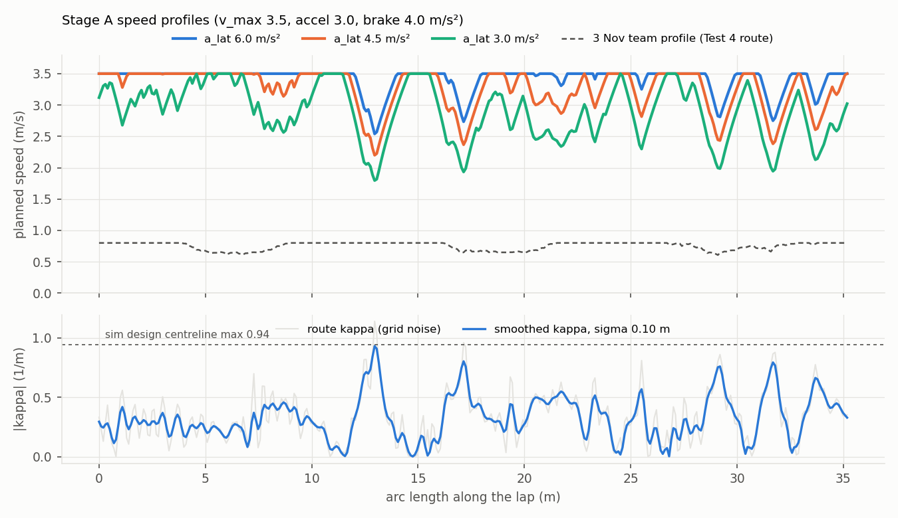
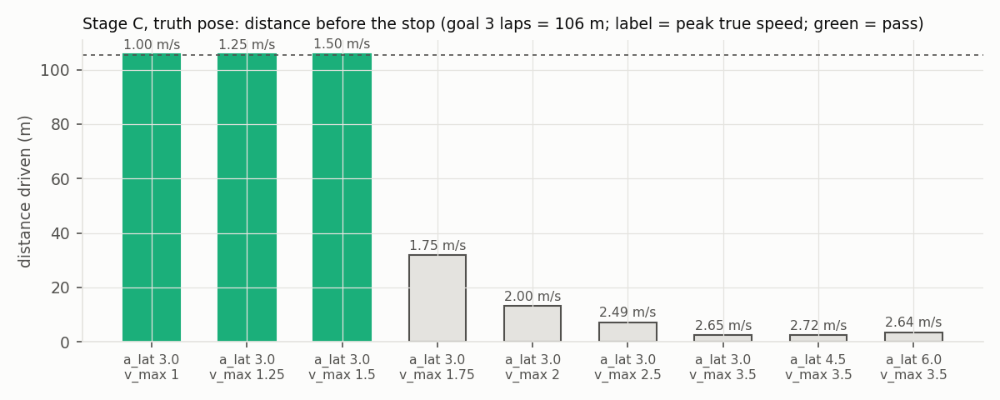
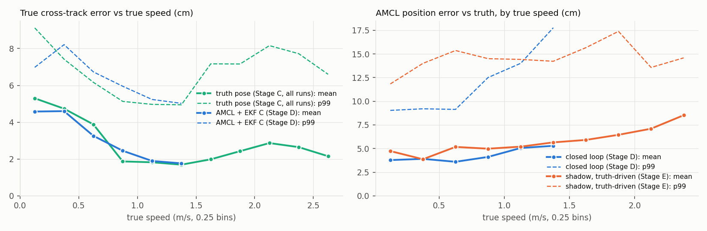
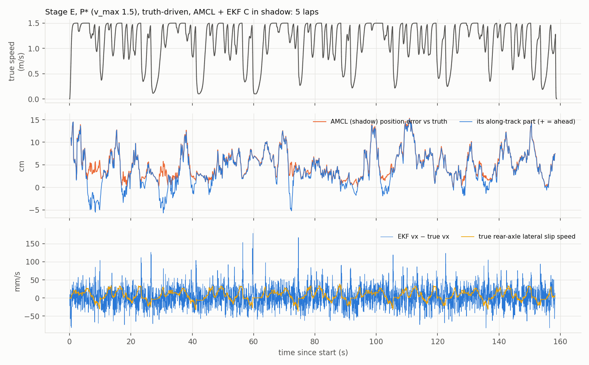
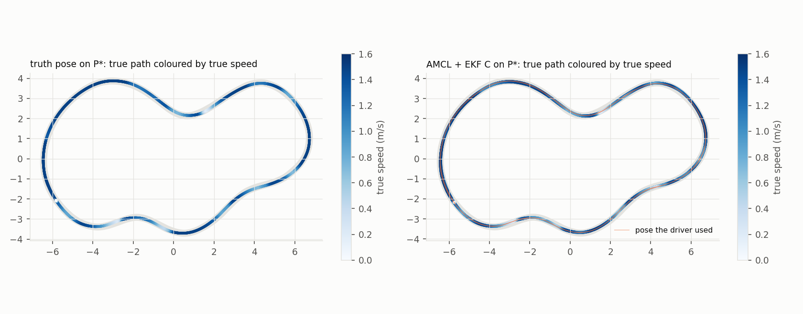

# Test 7: fast driver, then localization at speed (F1TENTH simulator)

Unattended run, 14 Nov 2026, 01:31–02:33 (Asia/Amman; times in the DECISIONS log are approximate, up to ~3 min late). The 6 h budget (until 07:31) was not needed.

**Setup** (as at the end of Test 6):
- estimation TF on `/fusion/tf`;
- 3 Nov map `results/missions/autonomous_20261103_114924_818822`;
- Nav2 AMCL with the team laser model (A0, `config/fusion_amcl_moatasem.yaml`);
- EKF C (`config/fusion_ekf_moatasem.yaml`) with `config/fusion_sim_sensors_calibrated.yaml` (seed 42);
- scan relay at 8.65 Hz (`min_period_s` 0.1).

**Rules followed:**
- No team file edited (the watchdog takes `max_speed` as a ROS argument).
- Every run was checked clean before and after, and stopped with one SIGINT per process group.
- No Foxglove or RViz, no power-profile change.

**Grading:** truth was used only for grading, plus as the stand-in localizer in Stage C and as the driver's pose in
Stage E. Grading is the Test 6 method (rear axle, fixed CAL_NT SE(2)). Wall clearance is the true car body
against the **simulator's own map**.

## Conclusion

- **What limits speed now: the controller, specifically the driver's swept-collision guard.** Not physics, not localization.
  - With the true pose, every profile above v_max 1.5 m/s ends in "stopping tube obstructed", with the car on
    the path and 0.18–0.38 m from the wall (C runs 2.0–3.5 m/s; peak 3.11 m/s).
  - The tube is v·reaction + v²/(2·4.0). The reaction time is hard-coded in the driver as max(0.35 s, scan
    age + 0.25 s), which is 0.42–0.58 s at 8.65 Hz scans. The tube is projected on the *current* steering
    arc, so on curve entries a 1.9–3.2 m tube reaches the wall even though the road curves away.
  - Raising the assumed braking from 0.7 to 4.0 m/s² moved the limit from 0.8–0.9 to 1.5–1.75 m/s. At
    2.5 m/s the reaction time alone is 1.3 m of the tube.
- **Physics is not reached.** The tyre limit at the tightest corner (R 1.06–1.08 m, design centreline) is
  ≈ 3.3 m/s. The fastest car (3.11 m/s, a_lat 6.0 profile) had 0.18 m of wall clearance when the guard stopped it.
- **Max speed validated: P* = a_lat 3.0 profile with v_max 1.5 m/s.**
  - **Truth pose:** 3/3 laps, lap 32.1–33.1 s, max 1.50 m/s, 2-s sustained 1.50, mean 1.09 m/s, max true CTE
    6.0 cm, min wall clearance 0.30 m.
  - **Estimated pose (AMCL + EKF C):** 5/5 laps, lap 31.7–34.6 s, max 1.50 / sustained 1.50 / mean 1.07 m/s,
    max CTE 8.4 cm, clearance 0.335 m.
  - **So estimated = truth at P*:** no localization limit, and the two conditional changes (30 Hz scans,
    Q_vx 0.5) were not needed.
  - The lap is only 1.4 s faster than the 0.8 m/s constant route (44.3 s → ~33 s). **The next limit inside
    P* is the driver's CTE speed reduction** (inherited from the team policy): speed is cut linearly from 2 cm of
    estimated CTE to 0.1 m/s at 6 cm, so the car dips to 0.1–0.4 m/s in most corners (see
    `shadow_errors_along_lap.png`). The new speed-scaled CTE hold, max(0.09, 0.06·v), only rises above 0.09 m
    beyond 1.5 m/s, so it never acts at P*.
- **Localization at speed (Stage E shadow, truth-driven, up to 3.1 m/s, 17 runs pooled):**
  - **AMCL error grows slowly:** RMSE 5–6 cm below 1.5 m/s, 7.8 cm at 1.5–2.0, 8.7 cm at 2.0–2.5, 9.4 cm at
    2.5–3.1 m/s; max ≤ 17.7 cm at every speed.
  - **It is almost entirely along the track, and AHEAD of truth**, not late: +3.6 cm at < 0.5 m/s rising to
    +9.0 cm at 2.5–3.1 m/s (≈ 2.6 cm + 22 ms × v).
  - **The EKF is fine at every speed:** vx error mean ≤ 10 mm/s, RMS ≤ 35 mm/s; yaw-rate error ≤ 0.45 °/s RMS.
  - **What grows is the unmodelled slip:** true rear-axle lateral speed RMS 3 → 91 mm/s, max 139 mm/s (≈ 3° slip
    angle) at 2.5–3.1 m/s. The EKF (and every decision so far) assumes it is zero.

### Do the Nov 7–10 localization decisions hold at speed?

| Decision | At P* (closed loop, ≤ 1.5 m/s) | Up to 3.1 m/s (shadow) |
|---|---|---|
| EKF gates off | holds: EKF vx bias ≤ 5 mm/s, yaw-rate ≤ 0.36 °/s | holds: no outliers; vx error RMS ≤ 35 mm/s |
| R = measured | holds | holds. One exception to watch: on straights at 2–3 m/s while accelerating, EKF vx is 35–44 mm/s *low* (lag of the filtered speed) |
| no rf2o | holds: slip RMS ≤ 22 mm/s | still holds for localization (AMCL error ≤ 9.4 cm RMSE), but slip grows to 91 mm/s RMS. It is the first quantity rf2o (or a slip-aware motion model) could correct; worth re-testing above 2.5 m/s once the driver can sustain it |
| Q values (Q_vx 0.05) | holds: not needed to change (no localization limit) | holds |
| AMCL over PF | holds: AMCL RMSE 5.7–5.8 cm closed loop, 7 % CPU | holds: RMSE ≤ 9.4 cm, max ≤ 17.7 cm, no lost episode |
| relay 8.65 Hz (Test 6) | holds | holds: AMCL updates 6–8 Hz at speed and still has no lag (it is ahead) |

**Caveats:**
- Above 2 m/s there are only 140 AMCL samples (25 above 2.5 m/s), from 12 short runs.
- AMCL's reported σ is 1.2–5.4× the real position error and 5–22× the real yaw error at speed, the same
  pessimism as in Test 4.

## Stage B: driver changes (all in `tools/navigation/profiled_amcl_drive_moatasem.py`, all parameters)

| parameter | default (= old behaviour) | Test 7 value | what it does |
|---|---|---|---|
| `guard_decel_mps2` | 0.7 | 4.0 | braking the swept-collision guard assumes (passed to the team's `trajectory_safety` functions as an argument; the team file is unchanged) |
| `scale_jump_limits_with_speed` (Test 6) | false | true | pose-step limit 0.2 m and AMCL-jump limit 0.45 m each get + measured speed × elapsed time (never below the old values) |
| `lookahead_base_m` / `lookahead_speed_gain_s` | 0.30 / 0.20 | 0.30 / 0.50 | L = base + gain·v … |
| `lookahead_min_m` / `lookahead_max_m` (new) | 0.25 / 0.60 | 0.60 / 1.60 | … clamped to [min, max] (was hard-coded in the team's `tracking_lookahead`) |
| `cte_hold_speed_gain_s` (new) | 0.0 | 0.06 | CTE hold = max(`max_path_cte_m` 0.09, gain·\|measured v\|); the CTE speed reduction uses the same limit |
| `ramp_accel_mps2` / `ramp_decel_mps2` (new) | 0.5 / 0.8 | 3.0 / 4.0 | command ramp (were the team `ramp_velocity` defaults); needed to follow a 3 / 4 m/s² profile |
| `max_tf_age_s` (new) | 0.45 | 0.45 (unchanged) | accepted age of `slam_map → fusion_base`; the stale-TF message now prints the age |
| `scan_buffer_len` (new) | 8 | 8 (unchanged) | scans kept for the guard's scan-to-odometry match |
| `max_allowed_speed_mps` bound (Test 6) | ≤ 5.0 | 1.0–3.5 | — |

**Start-up checks:** every Test 7 run started cleanly at 8.65 Hz, so `max_tf_age_s` and `scan_buffer_len` were left
at their defaults. The Test 6 start-up stops (2.0 / 3.0 m/s) happened at 30 Hz with a 0.27 s scan buffer.
The watchdog took `--max-speed v_max+0.05 --ros-args -p max_speed:=v_max+0.05`.

Other new files:
- `tools/navigation/moatasem_speed_profile.py` (Stage A).
- `tools/localization/amcl_shadow.launch.py` gained `amcl_pose_topic` and `amcl_tf_broadcast` (defaults
  `/amcl_pose`, `true`) for the shadow runs.

## Stage A: speed profiles

`v = min(3.5, sqrt(a_lat/|kappa|))`, forward pass accel 3.0, backward pass brake 4.0 m/s², closed loop.

**Curvature smoothing (decision 4).** The route's kappa column is grid noise (max 1.14 1/m). Kappa is recomputed
from the smoothed heading with **sigma 0.10 m**, which keeps the peak at 0.93 1/m; the simulator's design
centreline gives 0.94 (R 1.06 m). A 0.5 m sigma would have flattened it to 0.61 and overestimated corner speeds by 24 %.

| profile | lap (planned) | v min / mean / max (m/s) |
|---|---|---|
| a_lat 3.0 | 12.5 s | 1.80 / 2.82 / 3.50 |
| a_lat 4.5 | 10.9 s | 2.20 / 3.22 / 3.50 |
| a_lat 6.0 | 10.4 s | 2.54 / 3.40 / 3.50 |
| a_lat 3.0, v_max 2.5 / 2.0 / 1.75 / 1.5 / 1.25 / 1.0 (ladder, decision 11) | 14.5 / 17.7 / 20.2 / 23.5 / 28.2 / 35.3 s | — |

## Stage C: controller capability with the TRUE pose (3 laps each)

**Pass** = 3/3 laps, max true CTE < 0.15 m, min wall clearance > 0.05 m, no guard stop.

- **None of the three a_lat profiles passed.** Each was stopped by the guard within 3 m at 2.6–2.7 m/s.
- The car was neither oscillating nor cutting corners, so the lookahead gain was **not** tuned (decisions 10 and 20).
- A v_max ladder then found **P* = a_lat 3.0, v_max 1.5** (1.75 fails at 0.9 lap).

Guard stops (snapshot at the stop): tube length and blocking steering arc.

| run | stop idx | measured v | reaction | tube | steering | best proposal gap | est. CTE |
|---|---|---|---|---|---|---|---|
| a_lat 6.0 | 33 | 2.53 | 0.54 s | 2.88 m | −5.3° | +0.057 m | 3.3 cm |
| a_lat 4.5 | 20 | 2.69 | 0.58 s | 3.21 m | −5.4° | +0.038 m | 2.8 cm |
| a_lat 3.0 | 22 | 2.58 | 0.49 s | 2.78 m | −5.8° | +0.066 m | 2.2 cm |
| v_max 2.5 | 72 | 2.53 | 0.42 s | 1.89 m | −6.1° | +0.063 m | 0.5 cm |
| v_max 2.0 | 136 | 1.82 | 0.35 s | 1.07 m | +13.7° | −0.107 m | 4.6 cm |
| v_max 1.75 | 325 | 1.51 | 0.35 s | 0.84 m | +9.9° | +0.050 m | 4.0 cm |

**Caveat on the truth runs:** my truth relay is a Python node composing truth with the EKF transform. Above 2 m/s
the pose it hands the driver is 20–50 ms late, with up to 17 % frozen ticks (Stage E table, "driver pose err").
The guard decides from local scans + odometry, not from the map pose, so the guard stops are not caused by it,
but "truth" above 2 m/s is not a perfect reference.

## Stage D: ESTIMATED pose (AMCL A0 + EKF C), 5 laps

Two runs were first made **without** the `/fusion/tf` remap by my mistake (decision 15). They are kept as
`runs/invalid_D_*` and not used.

## Tables (all stages, generated from `results/test7/runs/*/eval.json`)

#### Stage C

| metric | C_truth_a3.0 | C_truth_a4.5 | C_truth_a6.0 | C_truth_a3.0_v2.5 | C_truth_a3.0_v2.0 | C_truth_a3.0_v1.75 | C_truth_a3.0_v1.5 | C_truth_a3.0_v1.25 | C_truth_a3.0_v1.0 |
|---|---|---|---|---|---|---|---|---|---|
| end | no safe local speed: measured/proposed stopping tube obstructed | no safe local speed: measured/proposed stopping tube obstructed | no safe local speed: measured/proposed stopping tube obstructed | no safe local speed: measured/proposed stopping tube obstructed | no safe local speed: measured/proposed stopping tube obstructed | no safe local speed: measured/proposed stopping tube obstructed | completed 3 estimated laps | completed 3 estimated laps | completed 3 estimated laps |
| true laps | 0.07 | 0.07 | 0.10 | 0.20 | 0.37 | 0.90 | 3.01 | 3.00 | 3.00 |
| lap times (s) | – | – | – | – | – | – | 32.7, 33.1, 32.1 | 33.4, 32.9, 33.6 | 37.8, 37.1, 37.3 |
| max / 2-s sustained / mean true speed (m/s) | 2.65 / 1.32 / 1.32 | 2.72 / 1.28 / 1.28 | 2.64 / 1.78 / 1.52 | 2.49 / 1.86 / 1.56 | 2.00 / 1.96 / 1.42 | 1.75 / 1.73 / 0.98 | 1.50 / 1.50 / 1.09 | 1.25 / 1.25 / 1.06 | 1.00 / 1.00 / 0.94 |
| true CTE mean / max (cm) | 2.7 / 7.8 | 2.3 / 5.8 | 3.3 / 8.3 | 2.9 / 7.2 | 3.1 / 9.1 | 3.7 / 7.5 | 2.8 / 6.0 | 2.1 / 5.2 | 1.4 / 4.3 |
| min wall clearance, body (m) | 0.345 | 0.376 | 0.290 | 0.297 | 0.308 | 0.301 | 0.301 | 0.306 | 0.308 |
| collisions | 0 | 0 | 0 | 0 | 0 | 0 | 0 | 0 | 0 |
| driver heading err mean / max (°) | 0.80 / 5.02 | 1.17 / 7.73 | 0.99 / 4.96 | 0.50 / 3.98 | 0.76 / 2.30 | 0.42 / 1.67 | 0.53 / 2.12 | 0.57 / 2.04 | 0.54 / 1.73 |
| driver pose err RMSE / max (cm) | 10.3 / 39.1 | 18.1 / 57.8 | 10.5 / 37.1 | 5.3 / 29.3 | 4.9 / 8.8 | 2.1 / 5.5 | 2.9 / 7.0 | 3.1 / 6.4 | 2.9 / 5.1 |
| AMCL err RMSE / max (cm) | – (truth) | – (truth) | – (truth) | – (truth) | – (truth) | – (truth) | – (truth) | – (truth) | – (truth) |
| AMCL σ/real pos · yaw | – (truth) | – (truth) | – (truth) | – (truth) | – (truth) | – (truth) | – (truth) | – (truth) | – (truth) |
| driver along-track err (cm, + ahead) / equiv. delay (ms) | -7.4 / 39 | -11.5 / 53 | -7.8 / 38 | -3.5 / 19 | -4.4 / 29 | -2.0 / 16 | -2.6 / 23 | -2.9 / 27 | -2.7 / 29 |
| AMCL along-track at receive (cm) / delay (ms) | – (truth) | – (truth) | – (truth) | – (truth) | – (truth) | – (truth) | – (truth) | – (truth) | – (truth) |
| EKF vx − true vx curve / straight (mm/s) | -3 / -39 | 19 / -40 | 4 / -42 | 26 / -8 | 7 / 1 | 9 / -1 | 6 / 3 | 5 / 3 | 3 / 3 |
| EKF yaw-rate err RMS curve (°/s) | 0.18 | 0.15 | 0.20 | 0.43 | 0.21 | 0.36 | 0.40 | 0.31 | 0.28 |
| true rear lateral slip RMS curve (mm/s) / max slip angle (°) | 56.6 / 1.54 | 68.9 / 2.27 | 65.4 / 2.54 | 62.2 / 2.07 | 41.8 / 1.74 | 33.6 / 2.10 | 23.1 / 1.85 | 15.0 / 1.13 | 9.9 / 0.86 |
| steering-rate std / max (°/s) | 14.4 / 71 | 16.5 / 80 | 13.3 / 79 | 11.5 / 78 | 9.9 / 62 | 10.3 / 60 | 9.9 / 65 | 9.0 / 51 | 8.0 / 42 |
| largest pose step (cm) / frozen ticks (%) | 18.2 / 4.8 | 15.6 / 10.5 | 21.7 / 6.7 | 19.2 / 2.6 | 15.2 / 0.0 | 13.6 / 0.0 | 12.4 / 0.0 | 10.2 / 0.0 | 8.3 / 0.0 |
| AMCL pose / scan rate (Hz) | – (truth) | – (truth) | – (truth) | – (truth) | – (truth) | – (truth) | – (truth) | – (truth) | – (truth) |
| CPU % amcl / ekf / driver / relay | 0 / 4 / 47 / 0 | 0 / 4 / 52 / 0 | 0 / 4 / 56 / 0 | 0 / 4 / 48 / 0 | 0 / 4 / 46 / 0 | 0 / 4 / 42 / 0 | 0 / 4 / 41 / 0 | 0 / 3 / 39 / 0 | 0 / 3 / 37 / 0 |

#### Stage D

| metric | D_amcl_a3.0_v1.5 | D_amcl_a3.0_v1.25 |
|---|---|---|
| end | completed 5 estimated laps | completed 5 estimated laps |
| true laps | 5.00 | 5.01 |
| lap times (s) | 32.8, 31.7, 34.6, 31.9, 34.3 | 34.4, 32.7, 33.1, 32.0, 33.7 |
| max / 2-s sustained / mean true speed (m/s) | 1.50 / 1.50 / 1.07 | 1.25 / 1.25 / 1.07 |
| true CTE mean / max (cm) | 2.6 / 8.4 | 2.0 / 6.1 |
| min wall clearance, body (m) | 0.335 | 0.343 |
| collisions | 0 | 0 |
| driver heading err mean / max (°) | 0.72 / 4.13 | 0.67 / 2.67 |
| driver pose err RMSE / max (cm) | 4.8 / 19.1 | 4.4 / 14.0 |
| AMCL err RMSE / max (cm) | 5.7 / 20.4 | 5.8 / 16.5 |
| AMCL σ/real pos · yaw | 2.9 · 5.6 | 2.8 · 6.0 |
| driver along-track err (cm, + ahead) / equiv. delay (ms) | 1.4 / -15 | 1.5 / -16 |
| AMCL along-track at receive (cm) / delay (ms) | -0.2 / 0 | 1.6 / -16 |
| EKF vx − true vx curve / straight (mm/s) | 5 / 4 | 3 / 3 |
| EKF yaw-rate err RMS curve (°/s) | 0.36 | 0.31 |
| true rear lateral slip RMS curve (mm/s) / max slip angle (°) | 22.2 / 2.00 | 14.6 / 1.14 |
| steering-rate std / max (°/s) | 11.3 / 78 | 9.6 / 57 |
| largest pose step (cm) / frozen ticks (%) | 13.3 / 0.0 | 10.3 / 0.0 |
| AMCL pose / scan rate (Hz) | 7.9 / 8.4 | 8.3 / 8.4 |
| CPU % amcl / ekf / driver / relay | 7 / 3 / 38 / 68 | 7 / 3 / 37 / 67 |

#### Stage E

| metric | E_shadow_a3.0 | E_shadow_a3.0_r2 | E_shadow_a3.0_r3 | E_shadow_a3.0_r4 | E_shadow_a6.0 | E_shadow_a6.0_r2 | E_shadow_a6.0_r3 | E_shadow_a6.0_r4 | E_shadow_a3.0_v2.5 | E_shadow_a3.0_v2.5_r2 | E_shadow_a3.0_v2.5_r3 | E_shadow_a3.0_v2.5_r4 | E_shadow_a3.0_v2.0 | E_shadow_a3.0_v2.0_r2 | E_shadow_a3.0_v2.0_r3 | E_shadow_a3.0_v2.0_r4 | E_shadow_a3.0_v1.5 |
|---|---|---|---|---|---|---|---|---|---|---|---|---|---|---|---|---|---|
| end | no safe local speed: measured/proposed stopping tube obstructed | estimated pose discontinuity | no safe local speed: measured/proposed stopping tube obstructed | no safe local speed: measured/proposed stopping tube obstructed | no safe local speed: measured/proposed stopping tube obstructed | no safe local speed: measured/proposed stopping tube obstructed | no safe local speed: measured/proposed stopping tube obstructed | no safe local speed: measured/proposed stopping tube obstructed | no safe local speed: measured/proposed stopping tube obstructed | no safe local speed: measured/proposed stopping tube obstructed | no safe local speed: measured/proposed stopping tube obstructed | no safe local speed: measured/proposed stopping tube obstructed | no safe local speed: measured/proposed stopping tube obstructed | no safe local speed: measured/proposed stopping tube obstructed | no safe local speed: measured/proposed stopping tube obstructed | no safe local speed: measured/proposed stopping tube obstructed | completed 5 estimated laps |
| true laps | 0.21 | 0.07 | 0.12 | 0.19 | 0.12 | 0.12 | 0.06 | 0.07 | 0.32 | 0.21 | 0.21 | 0.18 | 0.68 | 0.37 | 0.37 | 0.37 | 5.01 |
| lap times (s) | – | – | – | – | – | – | – | – | – | – | – | – | – | – | – | – | 31.7, 33.5, 30.8, 31.1, 31.3 |
| max / 2-s sustained / mean true speed (m/s) | 2.65 / 2.04 / 1.29 | 2.51 / 1.30 / 1.30 | 2.80 / 2.05 / 1.59 | 2.73 / 2.06 / 1.20 | 3.11 / 2.06 / 1.78 | 3.10 / 2.10 / 1.76 | 2.71 / 1.31 / 1.31 | 2.69 / 1.39 / 1.39 | 2.49 / 2.22 / 1.28 | 2.49 / 1.89 / 1.54 | 2.49 / 1.90 / 1.55 | 2.46 / 1.89 / 1.54 | 2.00 / 1.98 / 1.05 | 2.00 / 1.95 / 1.38 | 2.00 / 1.95 / 1.40 | 2.00 / 1.97 / 1.43 | 1.50 / 1.50 / 1.12 |
| true CTE mean / max (cm) | 3.7 / 8.6 | 2.2 / 5.5 | 4.2 / 9.0 | 3.8 / 8.1 | 4.1 / 13.4 | 4.6 / 12.7 | 2.1 / 5.7 | 2.3 / 7.4 | 3.9 / 8.6 | 2.7 / 7.2 | 2.7 / 7.2 | 2.8 / 7.0 | 4.0 / 8.5 | 3.1 / 8.7 | 3.1 / 8.5 | 3.0 / 8.9 | 2.7 / 6.4 |
| min wall clearance, body (m) | 0.279 | 0.366 | 0.270 | 0.279 | 0.183 | 0.200 | 0.366 | 0.338 | 0.313 | 0.312 | 0.308 | 0.290 | 0.323 | 0.306 | 0.308 | 0.308 | 0.301 |
| collisions | 0 | 0 | 0 | 0 | 0 | 0 | 0 | 0 | 0 | 0 | 0 | 0 | 0 | 0 | 0 | 0 | 0 |
| driver heading err mean / max (°) | 0.64 / 5.22 | 0.67 / 5.07 | 0.83 / 2.02 | 0.76 / 6.89 | 0.90 / 4.65 | 0.67 / 3.30 | 0.72 / 3.54 | 1.01 / 7.43 | 0.59 / 2.23 | 0.57 / 4.25 | 0.86 / 6.59 | 0.43 / 1.52 | 0.58 / 2.40 | 0.51 / 2.53 | 0.55 / 1.94 | 0.41 / 1.51 | 0.45 / 1.70 |
| driver pose err RMSE / max (cm) | 6.6 / 36.4 | 7.1 / 27.0 | 6.4 / 11.2 | 12.2 / 65.0 | 8.7 / 37.0 | 6.1 / 23.4 | 8.5 / 28.3 | 16.9 / 57.8 | 4.0 / 8.9 | 6.0 / 29.6 | 9.0 / 48.0 | 4.0 / 17.6 | 3.5 / 9.2 | 3.5 / 7.7 | 3.8 / 7.6 | 3.0 / 7.8 | 2.3 / 5.8 |
| AMCL err RMSE / max (cm) | 7.8 / 11.8 | 9.6 / 11.1 | 11.0 / 13.0 | 5.1 / 9.2 | 8.5 / 10.2 | 10.8 / 13.1 | 6.7 / 7.3 | 10.3 / 11.0 | 5.8 / 9.6 | 10.8 / 14.9 | 12.5 / 15.5 | 4.6 / 6.8 | 8.4 / 17.7 | 9.7 / 17.3 | 4.3 / 10.7 | 3.6 / 8.0 | 6.0 / 15.3 |
| AMCL σ/real pos · yaw | 2.6 · 10.2 | 1.2 · 9.6 | 1.4 · 16.2 | 4.1 · 6.6 | 1.6 · 21.8 | 1.4 · 12.1 | 2.0 · 8.0 | 1.5 · 18.5 | 3.8 · 6.7 | 2.1 · 6.9 | 1.7 · 6.3 | 3.5 · 7.9 | 2.3 · 4.8 | 1.8 · 5.0 | 5.4 · 6.0 | 5.0 · 5.2 | 2.8 · 5.7 |
| driver along-track err (cm, + ahead) / equiv. delay (ms) | -5.7 / 32 | -5.0 / 28 | -5.9 / 30 | -8.1 / 47 | -6.9 / 33 | -5.0 / 28 | -6.9 / 39 | -10.2 / 47 | -3.8 / 23 | -4.0 / 23 | -6.2 / 34 | -3.2 / 19 | -3.4 / 24 | -2.8 / 19 | -3.1 / 21 | -2.2 / 15 | -2.1 / 18 |
| AMCL along-track at receive (cm) / delay (ms) | 1.7 / -20 | 3.0 / -20 | 3.5 / -27 | -1.2 / 5 | 1.1 / -12 | 2.3 / -25 | 2.2 / -23 | 3.9 / -37 | 0.9 / -14 | 5.3 / -47 | 7.6 / -62 | 0.3 / -4 | -0.5 / -9 | 1.0 / -5 | -5.4 / 38 | -3.5 / 21 | 1.5 / -14 |
| EKF vx − true vx curve / straight (mm/s) | 16 / -14 | 19 / -40 | 22 / -36 | 20 / -13 | -8 / -35 | 13 / -44 | 4 / -38 | -17 / -43 | 25 / -16 | 28 / -8 | 21 / -10 | 16 / -6 | 19 / -1 | 11 / 2 | 4 / 3 | 11 / -2 | 6 / 3 |
| EKF yaw-rate err RMS curve (°/s) | 0.46 | 0.57 | 0.22 | 0.26 | 0.30 | 0.21 | 0.20 | 0.17 | 0.21 | 0.31 | 0.48 | 1.01 | 0.48 | 0.41 | 0.65 | 0.24 | 0.29 |
| true rear lateral slip RMS curve (mm/s) / max slip angle (°) | 65.5 / 2.41 | 65.4 / 2.10 | 83.3 / 2.35 | 72.7 / 2.48 | 83.6 / 2.18 | 98.9 / 2.56 | 54.8 / 1.51 | 61.5 / 1.73 | 69.8 / 3.01 | 61.0 / 2.14 | 61.2 / 2.25 | 65.6 / 2.16 | 48.7 / 2.44 | 42.7 / 2.02 | 42.5 / 1.85 | 42.8 / 1.86 | 23.9 / 1.72 |
| steering-rate std / max (°/s) | 9.7 / 70 | 13.3 / 72 | 11.2 / 71 | 7.3 / 32 | 12.0 / 71 | 11.7 / 70 | 5.5 / 21 | 16.7 / 80 | 7.4 / 37 | 6.0 / 27 | 5.8 / 28 | 4.0 / 14 | 11.0 / 74 | 10.3 / 60 | 10.5 / 59 | 9.8 / 55 | 9.9 / 63 |
| largest pose step (cm) / frozen ticks (%) | 18.4 / 2.6 | 16.1 / 4.5 | 19.3 / 0.0 | 19.8 / 4.2 | 21.1 / 3.2 | 21.2 / 6.1 | 23.5 / 5.6 | 15.7 / 16.7 | 17.5 / 0.0 | 17.9 / 2.4 | 20.2 / 2.5 | 17.8 / 1.4 | 15.9 / 0.0 | 15.5 / 0.0 | 15.1 / 0.0 | 16.1 / 0.0 | 12.2 / 0.0 |
| AMCL pose / scan rate (Hz) | 6.3 / 8.4 | 5.7 / 8.5 | 6.5 / 8.4 | 6.0 / 8.3 | 6.6 / 8.7 | 7.3 / 8.8 | 5.8 / 8.3 | 6.4 / 8.8 | 6.4 / 8.2 | 7.5 / 8.2 | 7.9 / 8.6 | 7.8 / 8.6 | 6.3 / 8.4 | 8.0 / 8.5 | 8.0 / 8.7 | 8.2 / 8.5 | 7.8 / 8.4 |
| CPU % amcl / ekf / driver / relay | 0 / 4 / 51 / 88 | 0 / 4 / 46 / 88 | 0 / 3 / 48 / 86 | 0 / 4 / 51 / 86 | 0 / 3 / 54 / 89 | 0 / 4 / 54 / 88 | 0 / 4 / 54 / 92 | 0 / 4 / 56 / 90 | 0 / 4 / 46 / 85 | 0 / 4 / 49 / 87 | 0 / 4 / 49 / 88 | 0 / 4 / 48 / 88 | 0 / 4 / 51 / 96 | 0 / 4 / 45 / 85 | 0 / 4 / 46 / 86 | 0 / 4 / 46 / 84 | 0 / 3 / 42 / 75 |

## Localization by true speed (pooled)

#### Stage E, shadow (truth-driven), all runs

| true speed (m/s) | AMCL samples | AMCL err RMSE / p95 / max (cm) | AMCL along-track mean (cm, + ahead) | EKF samples | EKF vx − true (mean / RMS, mm/s) | EKF yaw-rate err RMS (°/s) | true rear slip speed RMS / max (mm/s) |
|---|---|---|---|---|---|---|---|
| 0.0–0.5 | 119 | 5.2 / 11.3 / 14.0 | +3.6 | 1154 | -6 / 27 | 0.45 | 3 / 6 |
| 0.5–1.0 | 364 | 6.1 / 12.8 / 15.8 | +4.0 | 1334 | -1 / 35 | 0.43 | 5 / 29 |
| 1.0–1.5 | 1018 | 6.4 / 12.4 / 15.8 | +4.5 | 3628 | +4 / 29 | 0.32 | 18 / 61 |
| 1.5–2.0 | 230 | 7.8 / 16.2 / 17.7 | +4.6 | 826 | +7 / 34 | 0.35 | 37 / 86 |
| 2.0–2.5 | 115 | 8.7 / 13.2 / 14.9 | +7.7 | 411 | +10 / 32 | 0.42 | 59 / 120 |
| 2.5–3.2 | 25 | 9.4 / 12.2 / 13.1 | +9.0 | 91 | +6 / 35 | 0.28 | 91 / 139 |

#### Stage D, closed loop on AMCL + EKF C

| true speed (m/s) | AMCL samples | AMCL err RMSE / p95 / max (cm) | AMCL along-track mean (cm, + ahead) | EKF samples | EKF vx − true (mean / RMS, mm/s) | EKF yaw-rate err RMS (°/s) | true rear slip speed RMS / max (mm/s) |
|---|---|---|---|---|---|---|---|
| 0.0–0.5 | 116 | 4.3 / 8.4 / 9.8 | +3.1 | 767 | -3 / 25 | 0.50 | 3 / 8 |
| 0.5–1.0 | 714 | 4.6 / 8.2 / 16.5 | +3.1 | 2571 | +2 / 28 | 0.45 | 5 / 26 |
| 1.0–1.5 | 1845 | 6.2 / 12.1 / 20.4 | +4.1 | 6593 | +5 / 25 | 0.34 | 14 / 41 |
| 1.5–2.0 | 0 | – | – | 0 | – | – | – |
| 2.0–2.5 | 0 | – | – | 0 | – | – | – |
| 2.5–3.2 | 0 | – | – | 0 | – | – | – |

## DECISIONS log

| # | time | choice | alternatives | reason |
|---|---|---|---|---|
| 1 | 01:31 | Deadline 07:31 (6 h after start) | 09:00 | rule: whichever comes first |
| 2 | 01:33 | Guard braking passed to the team's `trajectory_safety` functions as an argument from my driver copy | edit trajectory_safety.py | it already takes `deceleration`; team files must not change |
| 3 | 01:33 | Make the driver's TF-age window and scan-buffer length parameters; add the measured age to the "stale map->base TF" message | leave as is | Test 6: 2.0/3.0 m/s stopped at start-up on these checks; "start-up checks must accept the new speeds" |
| 4 | 01:34 | Curvature smoothing sigma 0.10 m (heading smoothed, then kappa at half sigma, periodic) | 0.2–0.5 m | the route's own kappa is grid noise (max 1.14, step std 0.14); the sim's design centerline gives max 0.94 (R 1.06 m, 3-point fit over 0.3 m). sigma 0.10 keeps max 0.93 with 2.4× less noise; 0.5 m flattened it to 0.61 (corner speed +24 %, unsafe) |
| 5 | 01:36 | Command ramp made a parameter: +3.0 / −4.0 m/s² in Test 7 runs (default +0.5 / −0.8) | keep 0.5 / 0.8 | the driver could not follow a 3 / 4 m/s² profile (0.8 m/s² braking from 3.5 to 1.8 m/s needs 6 m) |
| 6 | 01:36 | CTE speed reduction uses the same speed-scaled CTE limit | keep 0.09 there | with 0.09 the speed halves at 4 cm CTE, which defeats the scaled hold |
| 7 | 01:36 | Wall clearance graded against the SIMULATOR's own map (maps/uj_technical_loop_v1) at the TRUE pose, body rectangle from sim_laser_geometry.yaml | the SLAM map | the sim map is the world the car collides with; validated on Test 6 run: min 0.341 m vs route audit 0.354 m |
| 8 | 01:36 | Shadow mode: AMCL launched with `amcl_pose_topic:=/shadow/amcl_pose amcl_tf_broadcast:=false`; truth relay owns map->odom | separate AMCL launch | one launch file, defaults unchanged |
| 9 | 01:37 | Clean check also excludes processes started from my tool's own shell (command line contains .claude/shell-snapshots/) | ancestors only | a sibling fork of my tool shell carries the same command line (with 'amcl') and aborted the first smoke run before it started; the rule says to exclude my own shell |
| 10 | 01:41 | Stage C: none of a_lat 6.0 / 4.5 / 3.0 passes (guard stop within 3 m at 2.6–2.7 m/s, truth pose). No lookahead tuning | tune lookahead (allowed only for oscillation / corner cutting) | the failure is the guard (CTE ≤ 8 cm, wall clearance ≥ 0.29 m), not oscillation or corner cutting |
| 11 | 01:41 | Add a v_max ladder on the a_lat 3.0 profile (2.5, 2.0, 1.5, 1.25, 1.0 m/s), truth, 3 laps each; P* = fastest that passes | lower a_lat; stop the test | the guard limit depends on speed (tube = v·reaction + v²/(2·4.0), reaction 0.35–0.5 s), not on curvature; Stage D needs a P* |
| 12 | 01:52 | Ladder: 2.5 and 2.0 fail (guard), 1.5 / 1.25 / 1.0 pass. Add one rung at 1.75 to refine P* | take 1.5 as P* now | 6 h budget leaves time; the pass/fail boundary is between 1.5 and 2.0 |
| 13 | 01:53 | P* = a_lat 3.0 profile with v_max 1.5 m/s (passes 3/3, CTE max 0.060, clearance 0.301); next slower = v_max 1.25. 1.75 fails at 0.90 lap (guard) | 1.25 as P* | rule: fastest passing profile |
| 14 | 01:53 | Stage D expected time 5 laps x 33 s + 15 s = 180 s (2x = 360 s), using the measured truth lap time | profile lap time (23.5 s) | the truth runs show the driver's CTE slow-down keeps the mean at ~1.1 m/s |
| 15 | 02:02 | Stage D runs D_amcl_* (01:53–02:00) are INVALID: my batch did not set FUSION_TF=1, so they ran with the full /tf (driver CPU 102 %). Kept in runs/ as `invalid_D_*`, rerun with /fusion/tf; runner now defaults to /fusion/tf | report them | rule: setup as at the end of Test 6 (/fusion/tf remap) |
| 16 | 02:02 | Clean check also excludes direct children of its ancestor shells (the runner's own `tee`, whose path contained "amcl", showed as NOT CLEAN in the printed line; the separate gating check had passed) | rename runs | keeps run names readable; only my own runner's processes are excluded |
| 17 | 02:10 | Stage D (rerun, /fusion/tf): both P* (v_max 1.5) and v_max 1.25 complete 5/5 laps with AMCL + EKF C → no localization limit at P*; the conditional changes (30 Hz relay, Q_vx 0.5) are NOT run | run them anyway | rule: only "if estimated fails but truth passed" |
| 18 | 02:10 | Stage E: shadow on P* (5 laps) as specified, PLUS shadow runs on the faster profiles (v_max 2.0, a_lat 3.0 and 6.0 with v_max 3.5), which end in guard stops after 3–13 m but give AMCL/EKF data at 1.8–2.7 m/s | P* only | P* tops out at 1.5 m/s; the test asks for localization at speed; the extra runs change nothing in the driver |
| 19 | 02:19 | Repeat the 4 fast shadow runs 3x each (names _r2.._r4) to pool AMCL/EKF samples at 1.5–3.1 m/s | stop here | a single short run gives only 12–72 AMCL samples above 1.5 m/s; time budget allows ~15 min; no driver or localizer change |
| 20 | 02:34 | No lookahead-gain tuning in Stage C | try gains 0.3 / 0.4 | rule allows it only for oscillation or corner cutting: at P* only 40 % of |CTE| > 2 cm samples are on the inside of the curve (mean offset 0.6 cm OUTSIDE), steering-rate std 9.9 °/s (Test 6: 8–11). The speed dips at P* come from the driver's CTE speed reduction (2 cm → 0.1 m/s at 6 cm), not from the lookahead |

## Incidents
- **Clean check matched my own shells twice:** a sibling fork of my tool shell, and the runner's `tee` whose path
  contained "amcl". The first aborted a smoke run before anything started. The second appeared only in the
  printed line: the separate gating check passed and nothing else was running. Fixed (decisions 9, 16).
- **Stage D without `/fusion/tf`:** see decision 15; rerun.
- **CPU figure missing in some runs:** in shadow runs the runner's AMCL CPU field shows 0 because it picked the
  truth relay's PID. Per-process figures are in each run's `cpu_all.txt` (P* shadow run: AMCL 7.0 %, truth relay
  33 %, driver 42 %, EKF 3.4 %).
- **One shadow run ended on "estimated pose discontinuity"** (a3.0_r2): truth-relay lag at 2.5 m/s. It is a test-tool artefact.
- **Clean checks:** 31 simulator runs. All 31 were clean after the run. 29 printed a clean pre-run check; the 2 invalid Stage D runs printed "NOT CLEAN" for the runner's own `tee` (the separate gating check passed). No kill -9, no shutdown warning, no run reached 2× its expected time.

## Raw data and scripts (untracked)
`results/test7/` (1.2 GB; `runs/check_t6_v0.8` is a copy of a Test 6 run used to validate the clearance metric):
- `profiles/`
- `runs/<run>/`: bag, driver CSV, logs, cpu, eval.json/npz
- `scripts/` (`run_t7.sh` and frozen copies, `eval_t7.py`, `eval_base.py`, `analyze_t7.py`,
  `plot_profiles.py`, `check_clean.sh`, batch scripts, `fast_params.txt`)
- `DECISIONS.md`, `pooled_by_speed.md`

## Proposed commit (not made; files by name, never `git add -A`)
Test 7:
- `tools/navigation/profiled_amcl_drive_moatasem.py` (Test 6 + Test 7 parameters)
- `tools/navigation/moatasem_speed_profile.py` (new)
- `tools/localization/amcl_shadow.launch.py` (Test 6 + Test 7 launch arguments)
- `tools/localization/moatasem_truth_pose_relay.py` (new in Test 6)
- `docs/moatasem_results/test7_fast_driver/`

Still pending from Test 6 (if not committed yet):
- `tools/navigation/drive_watchdog.py` (team, approved change)
- `docs/moatasem_results/test6_speed_sweep/`

Not to commit: `results/` (raw data), and the six team files with local `~/Data` path edits.
